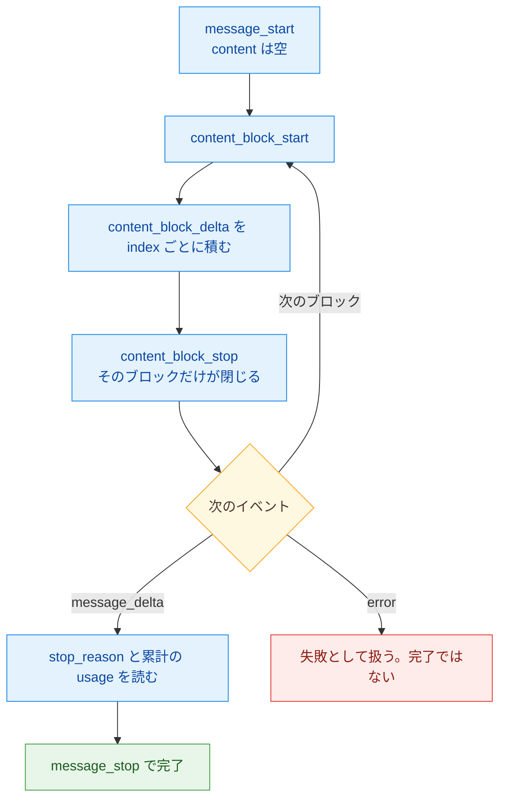

# ストリーミングのイベントと終わりの判定

> ドメイン: 2. アプリケーションと統合（20%） ／ 更新: 2026-11-26

!!! abstract "ひとことで"
    ストリームの終わりは ==`message_stop`== で、止まった理由は `message_delta` の `stop_reason` で知る。HTTP 200 が返った後でも、`error` イベントで失敗することがある。

## 仕組み

`"stream": true` を付けると、応答が server-sent events（SSE）で少しずつ届く。順番は決まっていて、`message_start`、ブロックごとの `content_block_start`・`content_block_delta`・`content_block_stop`、1回以上の `message_delta`、最後に `message_stop` が来る。各ブロックの `index` は、最終的な `content` 配列の位置と一致する。途中には `ping` が何度でも挟まりうるし、新しい種類のイベントが足されることもあるので、知らないイベントは無視して読み進める。



| delta の種類 | 中身 | 扱い |
|---|---|---|
| `text_delta` | テキストの断片 | 順につなぐ |
| `input_json_delta` | `tool_use` の `input` の、部分的な JSON 文字列 | `index` ごとに文字列をつなぎ、`content_block_stop` で一度だけパースする |
| `thinking_delta` | 思考の断片 | つなぐ。`display: "omitted"` なら本文は空 |
| `signature_delta` | 思考ブロックの署名 | `content_block_stop` の直前に1回来る。ブロックと一緒に保存して返す |

`message_delta` の `usage` は ==累計の値== なので、足し合わせない。`stop_reason` は `message_start` では `null` で、`message_delta` にだけ入る。

ストリームが始まった後の失敗は、HTTP の状態コードではなく `error` イベントで届く。混雑時には、通常なら 529 にあたる `overloaded_error` がここで来る。SDK はこのとき要求を再試行しない。SDK が投げる例外の状態コードは 200 か空なので、状態コードで分ける処理には引っかからず、`error.type` で分ける。接続が途中で切れたときは `error` イベントすら来ない。だから `message_stop` が届いたかを、完了の条件にする。

??? info "細かい決まりと再開のしかた"
    - SDK の集約ヘルパー（Python `stream.get_final_message()`、TypeScript `stream.finalMessage()`）を使うと、思考の署名も含めた完全な `Message` が組み上がる。自分で delta をつなぐより安全
    - `input_json_delta`: API は `input` のキーと値が揃うまでためてから、まとめて送る。値の生成中は、イベントの間が空くことがある
    - 中身の delta が無く、丸ごと届くブロックがある（`redacted_thinking`、`web_search_tool_result` などのサーバーツールの結果）
    - 途中で切れた応答の再開: Claude 4.6 以降は、受け取った部分と「続きから書いて」という指示を新しい user メッセージに入れて送る（4.5 以前は部分を assistant に置く）。`tool_use` と `thinking` のブロックは途中から再開できず、最後のテキストブロックから再開する
    - SDK は、非ストリーミング要求が10分のタイムアウトを超えそうでないかを検証する。大きな `max_tokens` にはストリーミングかバッチを使う
    - PHP SDK では、サーバーが途中で接続を閉じると、エラー無しにストリームが終わる。`message_stop` が届いたかを確かめる

## 試験での見分け方

<div class="vs" markdown>

| 問われること | ○ 正しい | × ひっかけ |
|---|---|---|
| ツールの引数のパースが壊れる | `partial_json` を `index` ごとにつなぎ、ブロックが閉じてからパースする | delta が来るたびに `JSON.parse` する |
| 途中の `overloaded_error` | `error.type` で見分け、失敗として扱う。再試行は自分で組む | SDK が自動で再試行すると考える。状態コード 529 の分岐で拾えると考える |
| 使用量の集計 | 最後の `message_delta` の `usage` を使う | イベントごとの `output_tokens` を合計する |
| 知らないイベント | 無視して読み進める | 例外にしてストリームを打ち切る |

</div>

## 確認問題

**Q1.** 物流会社の配送照会エージェントが、ストリーミングでツールを呼ぶ。ログには次の例外が多い。直し方として最も適切なものはどれか。（1つ選べ）
{ .quiz-q }

```text
event: content_block_delta  {"index":1,"delta":{"type":"input_json_delta","partial_json":"{\"tracking_no\":"}}
handler: JSON.parse(delta.partial_json) -> SyntaxError: Unexpected end of JSON input
```

<div class="quiz" data-answer="C" markdown>

- A. ツールを使う要求だけ非ストリーミングに切り替え、応答全体を一度に受け取る
- B. パースに失敗したら、同じ要求を指数バックオフで送り直す
- C. `partial_json` を `index` ごとにつなぎ、`content_block_stop` を受けてから一度だけパースする
- D. システムプロンプトで、ツールの引数を短い1行の JSON で書くよう指示する

</div>

??? success "答えと解説"
    **正解: C。** `input_json_delta` は部分的な JSON 文字列で、完成した `input` はブロックが閉じたときにそろう。

    - A: ストリーミングの体験を捨てるうえ、受け取り側の欠陥は残る
    - B: 部分文字列をパースする限り、何度送っても同じ所で失敗する
    - D: 断片の切れ目は API が決める。引数を短くしても、途中で切れた文字列は届く

**Q2.** 社内検索の回答画面が、ストリーミングで答えを表示する。混雑した時間帯に、答えが途中で止まったまま「完了」と表示されることがある。ログでは、テキストの delta の後に `event: error`（`"type": "overloaded_error"`）が届いている。例外処理は `RateLimitError` と `OverloadedError`（状態コード 429・529）の分岐だけで、それ以外は握りつぶして表示を完了にしている。直し方として適切なものはどれか。（2つ選べ）
{ .quiz-q }

<div class="quiz" data-answer="B,E" markdown>

- A. SDK の `max_retries` を増やし、ストリームの途中で落ちた要求も自動で再試行させる
- B. ストリームの例外は `error.type` で分け、`overloaded_error` なら再試行か再開の処理に回す
- C. `max_tokens` を上げ、長い答えでも出力の上限に届かないようにする
- D. `error` イベントを `ping` と同じく無視し、次のイベントを待ち続ける
- E. `message_stop` を受け取ったときだけ完了と表示し、それ以外は未完了として扱う

</div>

??? success "答えと解説"
    **正解: B と E。** ストリームの途中の失敗は `error` イベントで来て、状態コードは 200 か空になる。完了は `message_stop` で判定する。

    - A: SDK はストリームの中の失敗を再試行しない。`max_retries` は効かない
    - C: 原因は過負荷で、出力の上限ではない
    - D: `error` の後に続きは来ない。待っても完了しない

**Q3.** ある SaaS が、利用者ごとの出力トークンを集計している。1回の応答のログと集計コードは次のとおりで、請求額が実際より多い。最も適切な直し方はどれか。（1つ選べ）
{ .quiz-q }

```text
message_start  usage.output_tokens=1
message_delta  usage.output_tokens=15
total += 各イベントの usage.output_tokens   # → 16
```

<div class="quiz" data-answer="A" markdown>

- A. `message_delta` の `usage` は累計なので、最後の `message_delta` の値をその応答の出力トークンにする
- B. `text_delta` の文字数を数え、4で割った値を出力トークンとして記録する
- C. 要求の `max_tokens` を、その応答の出力トークンとして記録する
- D. `message_start` の値は捨て、すべての `content_block_delta` の数を足す

</div>

??? success "答えと解説"
    **正解: A。** `message_delta` の `usage` のトークン数は累計で、足し合わせると二重に数える。

    - B: 文字数からの換算は概算にすぎず、思考のトークンも数えられない
    - C: `max_tokens` は上限で、実際の出力量ではない
    - D: delta の数はトークン数と一致しない

## 出典
- Claude Certified Developer – Foundations Exam Guide v1.1, Domain 2「Integration Resilience」（公式、PDF）: https://cc.sj-cdn.net/instructor/6nizmqk8tpzpfjvt6qmmav7rh/public/1794946771/Claude_Certified_Developer_-_Foundations_Exam_Guide_Updated_Dec_7.pdf
- [Streaming messages](https://platform.claude.com/docs/en/build-with-claude/streaming)（公式。Event types、Error events、Content block delta types、Error recovery の節）
- [Handle errors](https://platform.claude.com/docs/en/api/handle-errors)（公式。Handle an error in a stream の節）
- [Claude API errors](https://platform.claude.com/docs/en/api/errors)（公式。SDK error types、Long requests の節）
- [Stop reasons and fallback](https://platform.claude.com/docs/en/build-with-claude/handling-stop-reasons)（公式。Stop reasons in streaming の節）
- [Thinking](https://platform.claude.com/docs/en/build-with-claude/thinking)（公式。Streaming thinking の節）
