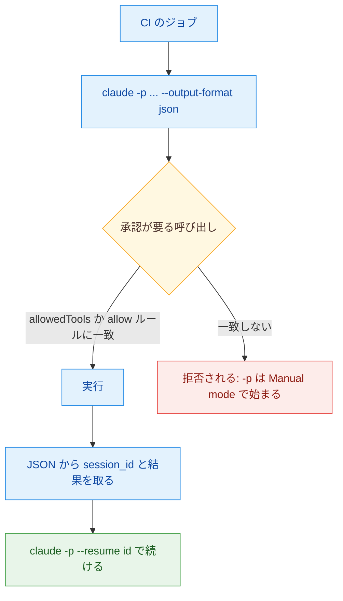

# Claude Code の操作（面、session、built-in commands、headless）

> ドメイン: 3. Claude Code（8%） ／ 更新: 2026-11-26

!!! abstract "ひとことで"
    CLI・desktop・IDE・web・mobile は同じエンジンで動き、リポジトリの CLAUDE.md・settings・MCP はどの面でも効く。スクリプトや CI では `claude -p` を使い、結果は `--output-format json` で受け取り、続きは ==`--resume <session_id>`== で指定して再開する。

## 仕組み

対話で使う面は、ターミナルの CLI、VS Code と JetBrains の拡張、desktop アプリ、ブラウザの claude.ai/code（iOS と Android のアプリからも使える）だ。どれも同じエンジンにつながる。作業は面をまたいで移せる。手元のセッションを携帯から続けるなら Remote Control、web で始めた作業をターミナルに引き取るなら `claude --teleport`、ターミナルのセッションを desktop で開くなら `/desktop` を使う。

自動化では、`-p`（`--print`）で対話なしに1回実行する。出力の形は `--output-format` で選ぶ。`text`（既定）、結果と session ID とメタデータを含む `json`、改行区切りの JSON イベントを流す `stream-json` の3つだ。スキーマに沿った出力が欲しければ、`--output-format json` に `--json-schema` を足す。結果は `result` でなく `structured_output` に入る。

| やりたいこと | 使うもの |
|---|---|
| 直近のセッションに戻る | `claude --continue`（今のディレクトリの直近） |
| 特定のセッションに戻る | `claude --resume <id か名前>`、セッション内では `/resume` |
| 元を残して別の方針を試す | `/branch`、または `--resume` / `--continue` に `--fork-session` |
| 文脈を空にして別の作業へ | `/clear`（前のセッションは保存され、`/resume` で戻れる） |
| 同じ作業のまま文脈を減らす | `/compact [指示]` |
| 何が文脈を食っているか見る | `/context` |
| 会話やコードを前の時点に戻す | `/rewind`（別名 `/checkpoint`・`/undo`） |

`-p` の実行は、権限モードを何も指定しないと Manual（`default`）で始まる（v2.1.302 以降）。承認が要る呼び出しは、allow ルールや hook などで許可されていなければ拒否される。だから CI では、必要なコマンドを `--allowedTools` で許すか、`--permission-mode` で基準を決めておく。

??? info "細かい決まり"
    - `stream-json` でトークンを逐次受け取るには `--verbose` と `--include-partial-messages` も付ける
    - `--bare` は hooks・skills・plugins・MCP・auto memory・CLAUDE.md の自動の読み込みを飛ばし、起動を速くする。スクリプトや SDK からの呼び出しに推奨され、将来 `-p` の既定になる予定。OAuth は使わず、`ANTHROPIC_API_KEY` などが要る
    - `--bare` を付けない `-p` は、信頼していないフォルダでも project の hooks と `.mcp.json` のサーバーを動かす。信頼のダイアログは出ない
    - `-p` と Agent SDK で作ったセッションは、セッションの一覧と `claude --continue` に出ない。`--resume <session-id>` で戻る（`claude -p --continue` は含める）
    - 再開しても `--mcp-config`・`--plugin-dir`・`--add-dir`・`--settings`・`--allowedTools` などは戻らないので、もう一度付ける
    - 同じセッションを2つの端末で同時に再開すると、1つの transcript に両方が書き込み、後で一部が欠けることがある。`--fork-session` を付ける
    - transcript は `~/.claude/projects/<project>/<session-id>.jsonl` に保存され、既定で30日後に消える（`cleanupPeriodDays`）
    - 主な built-in commands: `/init`（CLAUDE.md を作る）、`/memory`、`/permissions`、`/hooks`、`/mcp`、`/plugin`、`/skills`、`/model`、`/config`、`/status`（読み込んだ設定の出どころ）、`/usage`（`/cost` は別名）、`/doctor`、`/btw`（会話に足さない脇の質問）
    - `-p` では、skill と custom command は prompt に `/skill-name` を書けば動く。`/login` のように画面でしか動かないコマンドは使えない
    - `-p` は成功で終了コード 0、失敗で 0 以外を返す。SIGTERM で止めると 143

## 試験での見分け方

| 問われること | ○ 正しい | × ひっかけ |
|---|---|---|
| CI でスキーマどおりの出力を受け取る | `--json-schema` を付け、`structured_output` の有無を確かめて読む | `result` の文字列を JSON としてパースする |
| CI で前の実行の続きをする | JSON の `session_id` を保存し、`--resume <id>` で再開する | 並行するジョブがある環境で `--continue` に頼る |
| CI で承認が要る操作が拒否される | `--allowedTools` で必要なコマンドだけ許す | 共有のランナーで root のまま `--dangerously-skip-permissions` を付ける |
| 別の作業を始めたいが、後で戻りたい | `/clear` で空にし、戻るときは `/resume` | `/compact` で前の作業の要約を残したまま始める |

## 確認問題

**Q1.** CI で、変更されたファイルから API の一覧を抜き出すジョブを作った。コマンドは `claude -p "..." --output-format json --json-schema '<schema>'` で、次の工程はその出力の `.result` を JSON としてパースしている。パースがときどき失敗し、たまに出力にその欄が無いこともある。最も適切な直し方はどれか。（1つ選べ）
{ .quiz-q }

- A. `--output-format text` に変え、出力から正規表現で JSON の部分を切り出す
- B. `--output-format stream-json` に変え、最後のイベントのテキストをパースする
- C. `.structured_output` を読むように変え、その欄が無いときは失敗として扱う
- D. `--append-system-prompt` で「JSON 以外は出力しないこと」と指示する

??? success "答えと解説"
    **正解: C。** `--json-schema` の出力は `structured_output` に入る。拒否などで有効な出力が無いと、その欄は付かない。

    - A: スキーマの検証を捨て、壊れやすい切り出しに頼ることになる
    - B: ストリームにしても、スキーマどおりの出力の置き場は変わらない
    - D: prompt の指示は形式の保証にならず、読む欄の誤りも直らない

**Q2.** 夜間のジョブで、`claude -p "依存を更新してテストを通して"` を実行し、続けて `claude -p --continue "結果を要約して PR の本文を書いて"` を実行している。ログには `Bash(npm test)` が拒否された記録があり、テストは一度も走っていなかった。また、同じランナーで別のジョブが並行して動く日は、要約が別の作業のものになる。適切な対策はどれか。（2つ選べ）
{ .quiz-q }

- A. `--allowedTools "Bash(npm test *)"` のように、必要なコマンドだけを許可する
- B. 共有のランナーに root で入り、`--dangerously-skip-permissions` を付けて承認を飛ばす
- C. 2回目の実行で `--continue` に `--fork-session` を足す
- D. 1回目を `--output-format json` で実行して `session_id` を保存し、2回目は `--resume <session_id>` で続ける
- E. 対話モードで起動し、承認のプロンプトに CI のスクリプトから自動で答える

??? success "答えと解説"
    **正解: A と D。** `-p` は承認が要る呼び出しを拒否するので必要なものだけ許可し、続きは session ID で指定する。

    - B: root では起動を拒まれる。隔離されていない共有の環境で承認を飛ばすのも危ない
    - C: fork しても、どのセッションの直近を選ぶかは変わらない
    - E: 対話の画面に機械で答える作りは壊れやすい。`-p` と許可の設定で済む

**Q3.** 開発者が CLI で、ある不具合の調査を長く続けてきた。これから無関係な機能の実装を始めたいが、不具合の調査には明日戻りたい。最も適切な操作はどれか。（1つ選べ）
{ .quiz-q }

- A. `/compact 新しい機能の実装に集中` と打ち、同じ会話のまま実装を始める
- B. いったん終了し、`claude --continue` で起動し直してから実装を始める
- C. `/branch` で分岐し、分岐した側で実装を始める
- D. `/clear` で空の文脈から実装を始め、明日は `/resume` で調査のセッションに戻る

??? success "答えと解説"
    **正解: D。** `/clear` は前のセッションを保存したまま文脈を空にするので、無関係な作業を混ぜずに始められ、後で戻れる。

    - A: 調査の要約が残ったまま、無関係な作業が同じ会話に混ざる
    - B: `--continue` は同じ直近のセッションを開くだけで、文脈は空にならない
    - C: `/branch` は会話をそのまま写すので、調査の文脈を抱えたまま始めることになる

## 出典
- Claude Certified Developer – Foundations Exam Guide v1.1, Domain 3「Claude Code Operation」（公式、PDF）: https://cc.sj-cdn.net/instructor/6nizmqk8tpzpfjvt6qmmav7rh/public/1794946771/Claude_Certified_Developer_-_Foundations_Exam_Guide_Updated_Dec_7.pdf
- [Claude Code overview](https://code.claude.com/docs/en/overview)（公式）
- [Run Claude Code programmatically](https://code.claude.com/docs/en/headless)（公式）
- [Manage sessions](https://code.claude.com/docs/en/sessions)（公式）
- [Commands](https://code.claude.com/docs/en/commands)（公式）
- [Permission modes](https://code.claude.com/docs/en/permission-modes)（公式）
