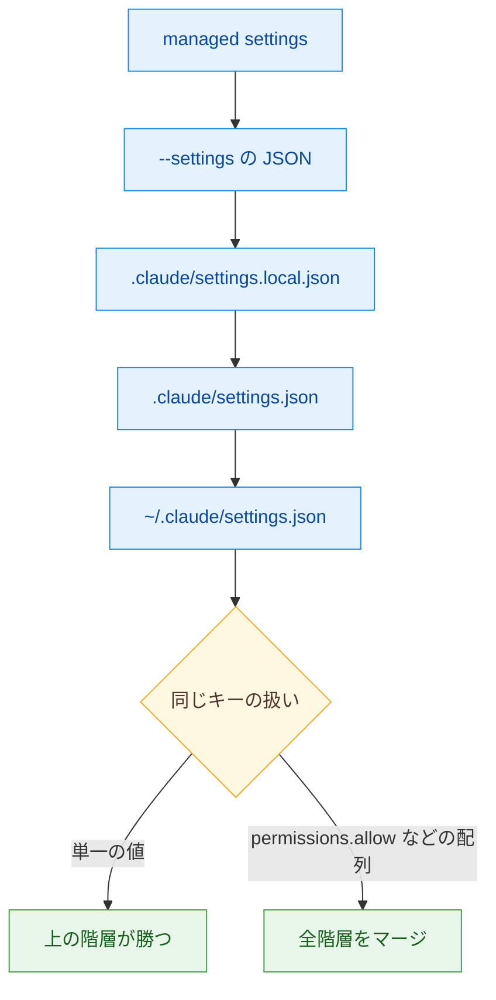

# CLAUDE.md の階層、settings.json、権限モード

> ドメイン: 3. Claude Code（8%） ／ 更新: 2026-11-26

!!! abstract "ひとことで"
    CLAUDE.md は ==文脈であって強制ではない==。見つかった階層がすべて連結され、どれも他を上書きしない。settings.json は managed > `--settings` > local > project > user の順に上が勝つが、`permissions.allow` などの配列はマージされる。必ず守らせる禁止は、settings の `deny` か hook に書く。

## 仕組み

CLAUDE.md は、起動したディレクトリとその上の全ディレクトリから、起動時に読み込まれる。内容はルート側から順に連結されるので、起動場所に近いファイルほど後ろに来る。サブディレクトリの CLAUDE.md は起動時には読まれず、Claude がそこのファイルを読み書きしたときに読み込まれる。指示が矛盾すると、Claude はどちらかを選ぶことがある。だから CLAUDE.md の階層は、優先順位でなく整合を保つことで管理する。

| CLAUDE.md の場所 | 範囲 |
|---|---|
| managed policy（例: Linux は `/etc/claude-code/CLAUDE.md`） | 組織の全員。`claudeMdExcludes` で外せない |
| `~/.claude/CLAUDE.md` | 自分の全プロジェクト |
| `./CLAUDE.md` か `./.claude/CLAUDE.md` | チーム（リポジトリに commit する） |
| `./CLAUDE.local.md` | 自分のこのプロジェクトだけ（`.gitignore` に入れる） |
| `.claude/rules/*.md` | `paths` の frontmatter が無ければ起動時に、あれば一致するファイルを扱うときに読まれる |

settings.json は値の決まり方が違う。同じキーが複数の階層にあれば、上の階層の値が使われる。

権限モードは、何を承認なしで動かすかの基準だ。

| モード | 承認なしで動くもの | 向く場面 |
|---|---|---|
| `default`（Manual） | 作業ディレクトリ内の読み取りなど、承認の要らない操作 | 慎重に扱う作業、見慣れないコード |
| `acceptEdits` | 上に加え、ファイルの編集と `mkdir`・`mv`・`cp` などの一般的なファイル操作 | 変更を自分で見直しながら進める |
| `plan` | 読み取り（auto mode が使えれば、classifier が承認したコマンドも） | 変更の前にコードを調べて計画を立てる |
| `auto` | ほぼすべて。classifier が裏で確認する | 長い作業で承認の手間を減らす |
| `dontAsk` | 読み取りと、事前に許可したツール。それ以外は拒否 | 固めた CI やスクリプト |
| `bypassPermissions` | すべて | 隔離したコンテナや VM だけ |

deny ルールはどのモードでも効き、`bypassPermissions` でも止める。allow ルールは `bypassPermissions` では意味を持たない。

??? info "細かい決まり"
    - CLAUDE.md の `@path` の import は、相対パスなら import を書いたファイルからの位置で解決し、最大4段まで辿る。import しても文脈の消費は減らない
    - 公式は、CLAUDE.md を1ファイル200行以内に保つよう勧めている
    - `AGENTS.md` は、作業ディレクトリかその上に CLAUDE.md・`.claude/CLAUDE.md`・`CLAUDE.local.md` が無いときに読まれる（Claude Code v2.1.277 以降）
    - `/init` は CLAUDE.md の雛形を作り、`/memory` は CLAUDE.md の編集と auto memory の切り替えをする
    - `permissions.defaultMode` の `auto` と `bypassPermissions` は、project と local の settings からは効かない。user か managed に書くか、`--permission-mode` を使う
    - commit した `.claude/settings.json` の `permissions.allow` は、各自がフォルダを trust するまで効かない。`deny` と `ask` はすぐ効く
    - 対話で「Yes, and don't ask again」を選ぶと、allow ルールが `.claude/settings.local.json` に書かれる。project か managed に ask ルールがあると、それは上書きできない
    - CLI では `Shift+Tab` でモードを切り替える（`default` → `acceptEdits` → `plan`）。対話のセッションの既定は、v2.1.283 以降 auto mode（使える環境の場合）。`-p` と Agent SDK は v2.1.302 以降 Manual で始まる
    - `--dangerously-skip-permissions` は `bypassPermissions` と同じ。Linux と macOS では root や sudo で起動できない
    - どのモードでも自動承認されないもの: 明示の ask ルールに一致する呼び出し、`AskUserQuestion`、重要なパスの `rm` など

## 試験での見分け方

| 問われること | ○ 正しい | × ひっかけ |
|---|---|---|
| 誰にも `.env` を読ませない | settings の `permissions.deny` に `Read(./.env)` を書く | CLAUDE.md に「読まないこと」と太字で書く |
| チームの設定を自分だけ変える | `.claude/settings.local.json` に書く | 共有の `.claude/settings.json` を書き換える |
| user と project の CLAUDE.md が矛盾 | 内容を整合させる | project が必ず勝つと考える |
| 他チームの CLAUDE.md が読み込まれる | `claudeMdExcludes` で外す | そのファイルを削除するよう頼む |

## 確認問題

**Q1.** 決済サービスのリポジトリで、セキュリティ担当が「Claude Code に `.env` を絶対に読ませない」ことを求めている。今は CLAUDE.md に「`.env` は読まないこと」と書いてあるが、ログでは Claude が `.env` を読んでいた。最も適切な直し方はどれか。（1つ選べ）
{ .quiz-q }

- A. CLAUDE.md の該当の行を太字にし、ファイルの先頭に移して目立たせる
- B. commit する `.claude/settings.json` の `permissions.deny` に `Read(./.env)` と `Read(./.env.*)` を書く
- C. `.claude/settings.json` の `permissions.allow` に、読んでよいファイルだけを並べる
- D. `paths: [".env"]` を持つ `.claude/rules/secrets.md` を作り、読まないよう指示する

??? success "答えと解説"
    **正解: B。** CLAUDE.md は文脈で強制ではない。deny ルールは、Claude の判断にかかわらず止める。

    - A: 目立たせても指示のままで、強制にならない
    - C: allow は承認なしで動かすものの一覧で、一覧に無いファイルを読むことは禁じない
    - D: rules も CLAUDE.md と同じく文脈で、強制にならない

**Q2.** 社内のモノレポで、開発者が `services/billing/` で Claude Code を起動した。リポジトリのルートと `services/` と `services/billing/legacy/` に、それぞれ CLAUDE.md がある。正しい説明はどれか。（2つ選べ）
{ .quiz-q }

- A. `services/billing/legacy/CLAUDE.md` も、起動した時点で読み込まれる
- B. `~/.claude/CLAUDE.md` とルートの CLAUDE.md が矛盾すると、ルートの内容が必ず優先される
- C. ルートと `services/` の CLAUDE.md は起動時に読み込まれ、ルート側から順に連結される
- D. 関係の無い他チームの CLAUDE.md を読ませたくなければ、`claudeMdExcludes` にそのパスを書く
- E. CLAUDE.md の `@path` の import は、何段でも辿って展開される

??? success "答えと解説"
    **正解: C と D。** 起動場所とその上の CLAUDE.md は起動時に連結され、不要なものは `claudeMdExcludes` で外せる。

    - A: サブディレクトリの CLAUDE.md は、そこのファイルを扱ったときに読み込まれる
    - B: CLAUDE.md は上書きでなく連結で、矛盾するとどちらに従うかは決まらない
    - E: import は最大4段まで

**Q3.** チームの `.claude/settings.json` には `"model": "claude-sonnet-5"` が書かれている。ある開発者は、このプロジェクトでだけ、自分のセッションを `claude-opus-5-5` で動かしたい。チームの他の人の設定は変えたくない。最も適切な方法はどれか。（1つ選べ）
{ .quiz-q }

- A. このプロジェクトの `.claude/settings.local.json` に `"model": "claude-opus-5-5"` を書く
- B. `~/.claude/settings.json` に `"model": "claude-opus-5-5"` を書く
- C. 共有の `.claude/settings.json` の `model` を書き換えて commit する
- D. CLAUDE.md に「このプロジェクトでは Opus を使うこと」と書く

??? success "答えと解説"
    **正解: A。** local は project より上の階層で、本人のこのプロジェクトにだけ効く。

    - B: user は project より下の階層なので、project の値に負ける
    - C: チーム全員の設定が変わる
    - D: CLAUDE.md は指示で、使うモデルの設定にはならない

## 出典
- Claude Certified Developer – Foundations Exam Guide v1.1, Domain 3「Claude Code Operation」（公式、PDF）: https://cc.sj-cdn.net/instructor/6nizmqk8tpzpfjvt6qmmav7rh/public/1794946771/Claude_Certified_Developer_-_Foundations_Exam_Guide_Updated_Dec_7.pdf
- [How Claude remembers your project](https://code.claude.com/docs/en/memory)（公式）
- [Settings files and precedence](https://code.claude.com/docs/en/settings)（公式）
- [Permission modes](https://code.claude.com/docs/en/permission-modes)（公式）
- [Configure permissions](https://code.claude.com/docs/en/agent-sdk/permissions)（公式、Agent SDK）
