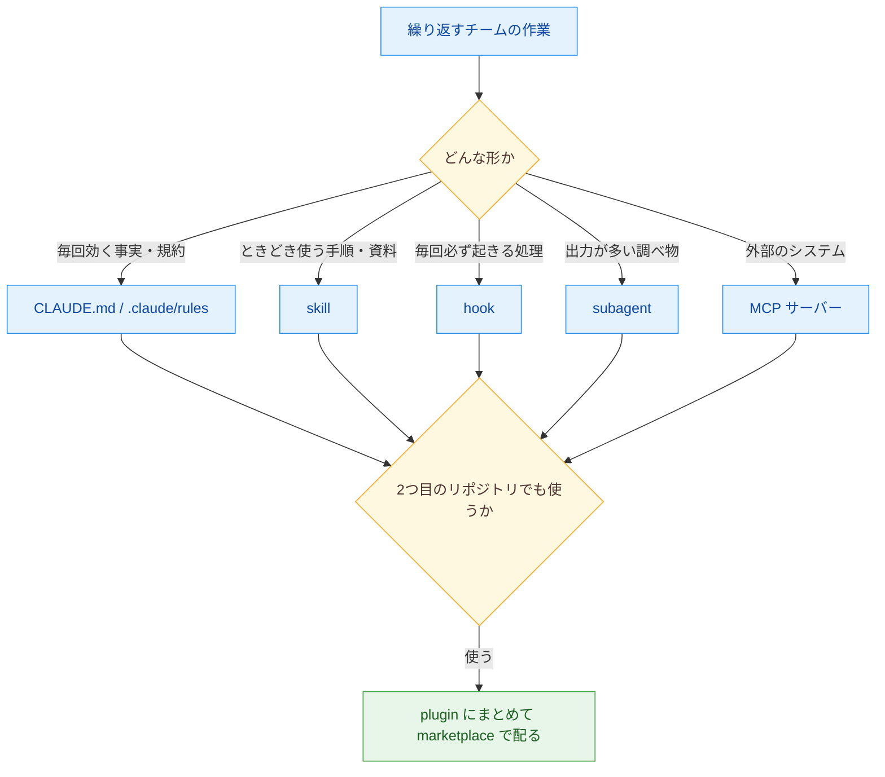

# 拡張の仕組みの選択と配布

> ドメイン: 3. Claude Code（8%） ／ 更新: 2026-11-26

!!! abstract "ひとことで"
    繰り返す作業の「形」で仕組みを選ぶ。毎回知っておくべき事実は CLAUDE.md か rules、ときどき使う手順や資料は skill、==必ず毎回起きるべき処理は hook==、文脈を汚す調べ物は subagent、外部のシステムは MCP にする。複数のリポジトリに配るなら plugin にまとめ、marketplace で配布する。

## 仕組み

仕組みごとに、いつ読み込まれ、誰が起動するかが違う。CLAUDE.md は毎回のリクエストに入る。skill は説明文だけが毎回入り、本文は呼ばれたときに読み込まれる。subagent は別のコンテキストで動き、要約だけを返す。hook は Claude の判断なしにイベントで動き、出力を返さなければ文脈を使わない。だから「必ず守らせたい」なら hook、「判断しながら手順を進めてほしい」なら skill になる。slash command は skill に統合済みで、`.claude/commands/` のファイルもそのまま動く。

| 仕組み | 置き場所 | 読み込み | 向く作業 |
|---|---|---|---|
| CLAUDE.md | `./CLAUDE.md` など | 毎回、全文 | ビルドのコマンド、「常に X する」規約 |
| rules | `.claude/rules/*.md` | 毎回、または `paths` に一致するファイルを扱うとき | 言語やディレクトリに固有の規約 |
| skill | `.claude/skills/<名前>/SKILL.md` | 説明文は毎回、本文は使うとき | `/release` の手順、API の規約集 |
| subagent | `.claude/agents/*.md` | 起動したとき、別のコンテキストで | 多くのファイルを読む調査、並列のレビュー |
| hook | settings の `hooks` | イベントのとき（文脈は使わない） | 編集後の整形、危険なコマンドの拒否 |
| MCP | `.mcp.json` など | ツール名は毎回、スキーマは必要なとき | DB、チケット管理、ブラウザ |
| plugin | `.claude-plugin/plugin.json` と各部品 | 有効にした全セッション | 上をまとめて複数リポジトリに配る |

skill の起動を制御するのは frontmatter だ。Claude は `description` を見て、いつ skill を読み込むかを決める。デプロイのように副作用がある手順は、`disable-model-invocation: true` で利用者が `/名前` と打ったときだけ動かす。サブエージェントで隔離して動かすなら `context: fork` を付ける。

??? info "細かい決まり"
    - skill の場所の優先は enterprise > personal（`~/.claude/skills/`）> project。plugin の skill は `/plugin名:skill名` と名前空間が付くので衝突しない。skill と command が同名なら skill が勝つ
    - skill の frontmatter: `name`、`description`（推奨）、`disable-model-invocation`、`user-invocable: false`（Claude だけが使う知識）、`allowed-tools`（その skill を呼んだターンで承認なしに使えるツール）、`context: fork` と `agent`、`paths`、`hooks`。知らないフィールドはエラーなしに無視される。`$ARGUMENTS` に引数が入る
    - `description` と `when_to_use` の合計は、一覧では 1,536 字で切られる。`SKILL.md` は500行以内にし、詳細は別ファイルに分ける
    - subagent の frontmatter は `name` と `description` が必須で、`tools`・`disallowedTools`・`model`・`permissionMode`・`skills`・`hooks`・`memory`・`isolation: worktree` などがある。同名の優先は managed > `--agents` > project > user > plugin
    - plugin の構成: `.claude-plugin/plugin.json`（名前・版）、`skills/`、`agents/`、`hooks/hooks.json`、`.mcp.json`。開発中は `--plugin-dir` で直接読み込む
    - marketplace は `.claude-plugin/marketplace.json` で plugin の一覧と取得元を示すカタログ。install の範囲は user・project・local の3つ。project の範囲では commit した `.claude/settings.json` で有効になるが、各自がそれぞれ install する
    - 有効にした plugin の skill・agent の説明文は、使わないセッションでも毎ターン文脈に入る

## 試験での見分け方

| 問われること | ○ 正しい | × ひっかけ |
|---|---|---|
| 週1回しか使わない長い手順が CLAUDE.md にある | skill に移す（副作用があれば `disable-model-invocation: true`） | `paths` の無い rules に移す（毎回読み込まれる点は同じ） |
| 毎回必ず走らせたい整形 | `PostToolUse` の hook | skill の説明文に「編集後に必ず実行」と書く |
| 複数リポジトリに版を付けて配る | plugin にまとめ、marketplace で配る | `.claude/` を各リポジトリにコピーする |
| 調査の出力でメインの会話が埋まる | subagent に任せて要約だけ受け取る | skill にして同じ会話の中で読ませる |

## 確認問題

**Q1.** あるチームの CLAUDE.md は300行あり、そのうち120行は週に1回だけ行うリリースの手順（タグ付け、変更履歴の作成、デプロイ）だ。普段の作業で Claude が規約を守らないことが増えている。最も適切な対応はどれか。（1つ選べ）
{ .quiz-q }

- A. リリースの手順を `/release` の skill に移し、`disable-model-invocation: true` を付ける
- B. リリースの手順を `paths` を付けない `.claude/rules/release.md` に分ける
- C. リリースの手順を hook にし、`Stop` のたびに実行させる
- D. CLAUDE.md の先頭に「リリースの手順は、リリースのときだけ参照すること」と書く

??? success "答えと解説"
    **正解: A。** ときどき使う手順は skill に移せば、本文は使うときだけ読み込まれる。デプロイを含むので、利用者が呼んだときだけ動かす。

    - B: `paths` の無い rules は起動時に読み込まれ、CLAUDE.md と同じだけ文脈を使う
    - C: 判断を要する手順で、毎回の停止で動かす作業でもない
    - D: 全文が毎回読み込まれる点が変わらない

**Q2.** プラットフォームチームが、レビュー用の skill、編集後に整形する hook、社内チケットの MCP サーバーを、12のリポジトリに配りたい。版を付けて更新を配る必要もある。適切な方法はどれか。（2つ選べ）
{ .quiz-q }

- A. 12のリポジトリそれぞれの `.claude/` に、skill・hook・MCP の設定をコピーして commit する
- B. `.claude-plugin/plugin.json`・`skills/`・`hooks/hooks.json`・`.mcp.json` を持つ plugin にまとめる
- C. 各開発者に、skill・hook・MCP の設定を自分の `~/.claude/` に手で置いてもらう
- D. plugin にした skill は名前空間なしの `/review` で呼べると、利用者向けの手順に書く
- E. 社内の marketplace（`.claude-plugin/marketplace.json`）で公開し、各リポジトリの `.claude/settings.json` で有効にする

??? success "答えと解説"
    **正解: B と E。** 複数の部品を1単位で配るなら plugin、版の更新を配るなら marketplace を使う。

    - A: 12か所の写しが別々に古くなり、版の管理ができない
    - C: 人によって中身がずれ、更新も配れない
    - D: plugin の skill は `/plugin名:review` のように名前空間が付く

**Q3.** TypeScript のリポジトリで、`.ts` のファイルを編集したら毎回 Prettier をかけたい。今は「編集後に Prettier を実行する」という説明文の skill があるが、ときどき実行されない。最も適切な対応はどれか。（1つ選べ）
{ .quiz-q }

- A. skill の `description` を「`.ts` を編集したら必ずこの skill を使うこと」と強い言い方に書き直す
- B. CLAUDE.md に「`.ts` を編集したら Prettier を実行すること」と書き足す
- C. `matcher` が `Edit|Write` の `PostToolUse` の hook で、編集されたファイルに Prettier をかける
- D. 整形だけを担当する subagent を作り、編集のたびに委任するよう指示する

??? success "答えと解説"
    **正解: C。** 毎回必ず起きるべき処理は、Claude の判断を通さない hook にする。

    - A: skill を使うかどうかは Claude の判断で、強い言い方でも保証にならない
    - B: CLAUDE.md も指示で、守られるかは揺れる
    - D: 委任するかは Claude の判断で、毎回の実行は保証されない。手間も増える

## 出典
- Claude Certified Developer – Foundations Exam Guide v1.1, Domain 3「Claude Code Customization and Extension」（公式、PDF）: https://cc.sj-cdn.net/instructor/6nizmqk8tpzpfjvt6qmmav7rh/public/1794946771/Claude_Certified_Developer_-_Foundations_Exam_Guide_Updated_Dec_7.pdf
- [Extend Claude Code](https://code.claude.com/docs/en/features-overview)（公式）
- [Skills](https://code.claude.com/docs/en/skills)（公式）
- [Subagents](https://code.claude.com/docs/en/sub-agents)（公式）
- [Plugins overview](https://code.claude.com/docs/en/plugins)（公式）
- [How Claude remembers your project](https://code.claude.com/docs/en/memory)（公式）
