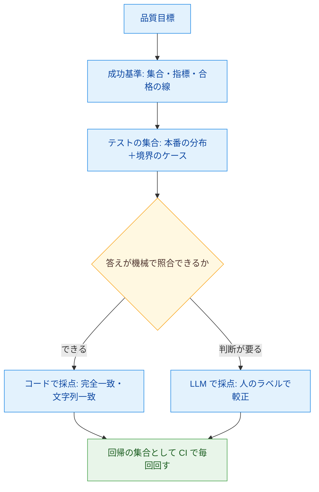

# 評価の設計（golden set・回帰テスト・振る舞いのチェック・指標）

> ドメイン: 4. 評価・テスト・デバッグ（10%） ／ 更新: 2026-11-26

!!! abstract "ひとことで"
    評価は、測りたい品質目標を==具体的で測定できる成功基準==に直すところから始める。採点は、速く確実なコードを先に使う。判断が要るところだけ LLM に任せ、人の採点は較正に回す。

## 仕組み

「良い応答」のような曖昧な目標は測れない。「ラベル付きの 2,000 件で F1 0.85 以上」のように、対象の集合・指標・合格の線を決める。たいていの用途は、正確さ・トーン・プライバシー・レイテンシー・コストなど、複数の基準を同時に持つ。テストの集合は本番の入力の分布をなぞり、そこに境界のケース（入力が空・長すぎる・無関係・人でも判断が割れる）を足す。

| 評価の種類 | 確かめること | 合格の目安 |
|---|---|---|
| golden set | 入力と期待する答え（または採点基準）を固定した集合で、品質を測る | 成功基準で決めた線 |
| 能力の評価（capability） | まだできないことが、どこまでできるようになったか | 低い通過率から始まってよい |
| 回帰テスト（regression） | 前にできていたことが、変更の後もできるか | ==ほぼ 100%==。落ちたら出荷を止める |
| 振る舞いのチェック（behavioral） | 「すべきときにする」と「すべきでないときにしない」の両方 | 両方向で測る |

指標は、答えの形に合わせて選ぶ。カテゴリを当てる仕事なら完全一致で、件数が偏るならカテゴリ別の F1 も見る。自由文なら参照文との重なり（ROUGE-L）か、LLM による採点を使う。エージェントは、通った道筋でなく最終的な結果（outcome）を採点する。道筋で採点すると、別の正しいやり方を誤りとして数えてしまう。

出力は毎回同じとは限らない。だから1つの課題を複数回（trial）走らせて数える。「k 回のうち1回でも通る」が pass@k、「k 回すべて通る」が pass^k だ。利用者が毎回の成功を期待する機能なら、**pass^k か1回あたりの成功率で測る**。

??? info "数字と細かい決まり"
    - 始めは、実際の失敗から集めた 20〜50 件の課題で十分（Anthropic のエンジニアリングブログ）
    - 公式ドキュメントは「質より量」を勧める。少数の手採点より、多数の自動採点の方が信号が多い
    - 採点の方法: 公式は「最も速く、確実で、規模を広げやすい方法を選ぶ」として、1. コード、2. 人、3. LLM の順に挙げ、それぞれの特徴を書いている。コードは最速・最も確実で規模も広げやすいが、規則で割り切れない判断には向かない。人は最も柔軟で質が高いが、遅く高いので、できるだけ避ける。LLM は速く柔軟で規模も広げられ、複雑な判断に向くが、先に信頼性を確かめてから規模を広げる
    - LLM で採点するときは、生成したモデルと別のモデルを使うのが一般に良いとされる
    - trial ごとに環境をまっさらから始める。状態が残ると、失敗が連動したり点が水増しされたりする
    - 全部の課題に通るようになった評価は「飽和」していて、改善を測れない。能力の評価で通過率が高くなった課題は、回帰の集合に移す

## 試験での見分け方

| 問われること | ○ 正しい | × ひっかけ |
|---|---|---|
| 目標の決め方 | 対象の集合・指標・合格の線を数字で決める | 「良い応答」を LLM に 1〜5 で付けさせて平均を見る |
| 分類の採点 | ラベル付きの golden set を完全一致で採点する | 正解が決まっている仕事に、LLM の採点や類似度を使う |
| 振る舞いのチェック | すべき事例とすべきでない事例の両方を入れる | 「すべき」事例だけで通過率を出す |
| 非決定性 | 複数回走らせ、pass^k か成功率で見る | 1回だけ走らせる。pass@k で信頼性を語る |
| エージェントの採点 | 最終的な結果を採点する | ツールを呼んだ順番が手本と一致するかで採点する |

## 確認問題

**Q1.** 社内の IT ヘルプデスクで、問い合わせを6つの担当カテゴリに振り分ける機能を作っている。品質の目標は「正しい担当に届くこと」。今の評価は、LLM が応答を「役に立つか」で 1〜5 で採点し、平均 4.3 を出している。だが本番では、振り分けの誤りの苦情が減らない。評価の作り直しとして最も適切なものはどれか。（1つ選べ）
{ .quiz-q }

- A. 採点のプロンプトに「振り分けの正しさも考慮すること」と足し、1〜5 の平均を引き続き見る
- B. 担当のラベルを付けた問い合わせの集合を作り、完全一致で採点して、カテゴリ別の F1 を出す
- C. 毎週 20 件を担当者が読んで印象を記録し、LLM の採点と並べて報告する
- D. 応答と、過去の模範応答との埋め込みの類似度を測り、平均が上がったかを見る

??? success "答えと解説"
    **正解: B。** 答えが決まっている分類は、ラベルとの完全一致で採点できる。件数の偏りもカテゴリ別の F1 で見える。

    - A: 測っているのは「役に立つか」という別の目標のままだ。正解の決まった仕事を LLM の採点に任せる理由も無い
    - C: 件数が少なく遅い。印象の記録は、測定できる基準にならない
    - D: 類似度は、言い回しが近いかを測るだけだ。担当が正しいかは分からない

**Q2.** サポートのエージェントは、返金額が規定を超える案件を人に回す（エスカレーションする）。評価の集合は「回すべき」案件 200 件だけで、通過率は 98% だ。ところが本番では、回す必要の無い案件まで人に回ってくる。評価の直し方として適切なものはどれか。（2つ選べ）
{ .quiz-q }

- A. 回すべきでない案件を集合に加え、「回さない」ことも正解として採点する
- B. 通過率の合格の線を 98% から 100% に上げ、同じ集合で測り直す
- C. 本番で誤って人に回された会話を集め、期待する答えを付けて集合に足す
- D. エスカレーションのツールを呼んだ順番が、手本の手順と一致するかで採点する
- E. 今の 200 件を LLM で言い換えて 1,000 件に増やし、統計の誤差を小さくする

??? success "答えと解説"
    **正解: A と C。** 振る舞いのチェックは両方向で測る。本番の実際の失敗は、集合に入れる最良の材料になる。

    - B: 「回すべきでない」事例が集合に無いので、線を上げても過剰なエスカレーションは測れない
    - D: 道筋でなく結果を採点する。手順の一致は、正しい別のやり方を誤りにする
    - E: 片方向だけの事例を増やしても、欠けている方向は測れない

**Q3.** 契約書から条項を抜き出すエージェントを評価している。各課題を3回ずつ走らせたら、多くの課題で3回中1〜2回だけ通った。チームは「pass@3 が 100% なので信頼性は十分」と報告した。利用者は、1回の実行で毎回正しく抜き出せることを期待している。報告の直し方として最も適切なものはどれか。（1つ選べ）
{ .quiz-q }

- A. 出力が揺れないよう `temperature` を 0 にして、各課題を1回だけ走らせて測り直す
- B. k を 3 から 10 に増やし、pass@10 で同じ結論になるかを確かめる
- C. 揺れは避けられないので、各課題の1回目の結果だけを採用して通過率を出す
- D. 3回すべて通った割合（pass^3）か、1回あたりの成功率で信頼性を報告する

??? success "答えと解説"
    **正解: D。** 毎回の成功が要るなら、「すべて通る」確率の pass^k か、1回あたりの成功率で測る。

    - A: 揺れを測らずに隠すだけだ。API の版によっては `temperature` を送れない（生成の仕組みのノートを参照）
    - B: pass@k は k を増やすほど上がる。「1回でも通る」の指標のままでは、毎回の信頼性は分からない
    - C: 1回だけの結果は偶然に左右される。揺れの大きさも測れない

## 出典
- Claude Certified Developer – Foundations Exam Guide v1.1, Domain 4 Evaluation Design（公式、PDF）: https://cc.sj-cdn.net/instructor/6nizmqk8tpzpfjvt6qmmav7rh/public/1794946771/Claude_Certified_Developer_-_Foundations_Exam_Guide_Updated_Dec_7.pdf
- [Define success criteria and build evaluations](https://platform.claude.com/docs/en/test-and-evaluate/develop-tests)（公式）
- [Demystifying evals for AI agents](https://www.anthropic.com/engineering/demystifying-evals-for-ai-agents)（公式、エンジニアリングブログ）
