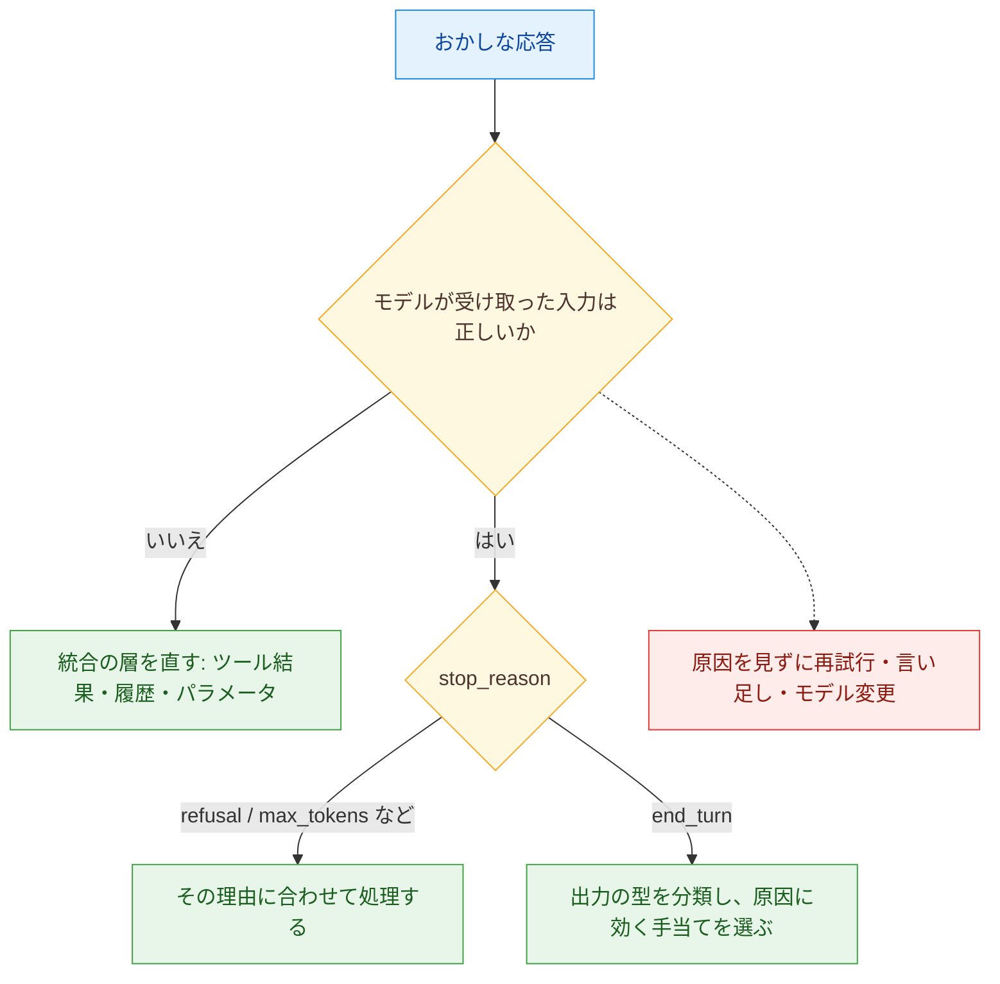

# 故障の型の診断（統合の層か、モデルの出力か）

> ドメイン: 4. 評価・テスト・デバッグ（10%） ／ 更新: 2026-11-26

!!! abstract "ひとことで"
    トレースから故障の型を見分け、==原因が統合の層（自分のコード・設定）にあるか、モデルの出力にあるか==を切り分ける。そのうえで原因に効く手当てを選ぶ。症状を抑えるだけの再試行やプロンプトの言い足しで済ませない。

## 仕組み

最初に見るのは、モデルが実際に何を受け取り、何を返したかだ。ツールの失敗を空の結果として返した、履歴を途中で切った、`stop_reason` を見ていない、といった統合の層の欠陥は、モデルの誤りに見える症状を生む。この場合、プロンプトを直してもモデルを替えても治らない。入力が正しいと確かめてから、初めてモデルの出力の型を疑う。

| 型 | トレースの手がかり | 原因に効く手当て |
|---|---|---|
| 幻覚（hallucination） | 渡した文書やツール結果に無い事実・数値・出典 | 「分からない」と言ってよいと許す。先に原文を引用させる。引用で裏付けられない主張は消させる |
| 拒否（refusal） | HTTP 200 で `stop_reason: "refusal"`、`stop_details` に理由の分類 | 拒否として分岐する。`stop_details` を読み、別のモデルで再試行する |
| 動きが足りない（under-acting） | 要るはずの検索や確認を飛ばして答える、早く止まる | effort を上げる。ツールの説明と「いつ使うか」を明確にする |
| 文脈の喪失（context loss） | 長いセッションで前の制約や事実を落とす | 履歴を切るコードを確かめる。要点を消えない場所に置く。compaction を使う |
| 形式の崩れ（format drift） | JSON が壊れる、余計な前置きが付く | structured outputs でスキーマを保証する。正規表現での修繕に頼らない |
| 出力の揺れ（inconsistent output） | 同じ入力で答えが変わる | 指示と例をはっきりさせる。出力の形を固定する。複数回走らせて評価する |

途中で切れた応答も、型を取り違えやすい。`max_tokens` や `model_context_window_exceeded` で止まった出力は不完全なので、形式の崩れと見誤らないようにする。同じリクエストを何度送っても、同じところで切れる。

??? info "細かい決まり"
    - `refusal` はエラーでなく通常の応答（HTTP 200）。`stop_details` は他の stop_reason では `null`。たいていは別の Claude のモデルで再試行すると応答が得られる。ただし分類が `reasoning_extraction`（内部の推論を本文に書かせようとした）のときは、モデルを替えずにプロンプトを直す
    - `max_tokens` で切れて `tool_use` が途中なら、上限を上げて送り直す。思考も `max_tokens` に含まれる
    - ツールが失敗したら、`tool_result` に `is_error: true` とエラーの中身を入れて返す。空の結果は「該当なし」と区別できない
    - `tool_result` の直後にテキストを足すと、中身の無い `end_turn` の応答を招くことがある。完了した応答をそのまま送り直しても同じ
    - 公式の幻覚対策: 「分からない」を許す、長い文書（2万トークン超）では先に一字一句の引用を抜き出させる、主張ごとに引用で裏付けさせる、渡した文書だけを使うよう指示する、同じプロンプトを複数回走らせて食い違いを見る。それでも幻覚は無くならないので、重要な情報は確かめる
    - Haiku 5.5 は effort が `low` だと、長いエージェントのプロンプトで検索を飛ばす・早く止まる・確認を省くことが増える（effort のページ）

## 試験での見分け方

| 問われること | ○ 正しい | × ひっかけ |
|---|---|---|
| ツールが失敗した後の誤答 | 統合の層を直し、`is_error` を付けて失敗を伝える | 幻覚とみなして「でっち上げるな」とプロンプトに足す |
| 途中で切れた JSON | `max_tokens` を上げるか effort を下げる | 正規表現で閉じ括弧を補う。同じリクエストを再試行する |
| `refusal` | 拒否として分岐し、`stop_details` を見て別のモデルで再試行する | サーバーエラーとして指数バックオフで同じモデルに再試行する |
| 検索を飛ばして答える | effort とツールの説明を見直す | 上位のモデルへの変更だけで済ませる |

## 確認問題

**Q1.** 金融機関の書類から項目を JSON で抜き出すパイプラインで、ときどきパースに失敗する。ログでは、失敗した応答はどれも `stop_reason: "max_tokens"` で、JSON が途中で終わっている。今のコードは、パースに失敗したら同じリクエストを3回送り直し、それでもだめなら「形式エラー」として人に回す。最も適切な直し方はどれか。（1つ選べ）
{ .quiz-q }

- A. システムプロンプトに「必ず完全で有効な JSON を返すこと」と書き足す
- B. 途中で切れた JSON の閉じ括弧を、正規表現で補ってからパースする
- C. 抜き出しの精度が足りないとみて、上位の階層のモデルに切り替える
- D. `max_tokens` で止まった応答は不完全として扱い、上限を上げるか effort を下げて送り直す

??? success "答えと解説"
    **正解: D。** 原因は形式の崩れでなく、出力の上限での打ち切りだ。上限と思考の量を見直す。

    - A: 上限で切れるのは指示の問題ではない。言い足しても同じところで切れる
    - B: 足りない項目は補えない。不完全なデータを完全なものとして流してしまう
    - C: 上位のモデルにしても、上限が同じなら切れる

**Q2.** サポートのエージェントのトレースを読んだ。`get_invoice` ツールはタイムアウトしたが、コードは例外を握りつぶし、`tool_result` の中身を空文字で返していた。エージェントは利用者に「該当する請求書はありません」と答えた。最も適切な対応はどれか。（1つ選べ）
{ .quiz-q }

- A. 幻覚とみて、システムプロンプトに「確かでない事実を作らないこと」と書き足す
- B. 推論の力が足りないとみて、エージェントを上位の階層のモデルに切り替える
- C. タイムアウトを `is_error: true` とエラーの内容を付けた `tool_result` で返すよう、コードを直す
- D. 応答を出す前に別の LLM で検査し、「ありません」を含む応答を止める仕組みを足す

??? success "答えと解説"
    **正解: C。** モデルは空の結果を「該当なし」と読んだだけだ。原因は統合の層にある。

    - A: モデルは受け取った入力どおりに答えている。指示を足しても空の結果の意味は変わらない
    - B: どのモデルでも、空の結果と失敗は区別できない
    - D: 症状を後から止めるだけで、原因が残る。正しい「ありません」まで止めてしまう

**Q3.** 医療機関の問診アシスタントで、まれに画面に空の返答が出る。ログには HTTP 200、`stop_reason: "refusal"`、`stop_details` に分類が入っていた。アプリは `content` のテキストをそのまま画面に出している。直し方として適切なものはどれか。（2つ選べ）
{ .quiz-q }

- A. 応答ごとに `stop_reason` を確かめ、`refusal` のときは通常の回答と別の処理に分ける
- B. 一時的な障害とみて、同じモデル・同じリクエストを指数バックオフで再試行する
- C. API のエラーとして例外を投げ、利用者に「サーバーエラー」と表示する
- D. `stop_details` の分類を読み、別のモデルで再試行する。内部の推論を求めたことが理由なら、プロンプトを直す
- E. 空の返答の後に「回答してください」という user メッセージを自動で足して送り直す

??? success "答えと解説"
    **正解: A と D。** `refusal` は HTTP 200 の通常の応答なので、`stop_reason` で分岐し、`stop_details` に合わせて手当てする。

    - B: 一時的な障害ではない。同じ条件で送り直しても、同じ判断になりやすい
    - C: エラーではないので、利用者に誤った理由を見せる
    - E: 拒否の理由を見ずに押し切る手当てで、原因に届かない

## 出典
- Claude Certified Developer – Foundations Exam Guide v1.1, Domain 4 Failure-Mode Diagnosis（公式、PDF）: https://cc.sj-cdn.net/instructor/6nizmqk8tpzpfjvt6qmmav7rh/public/1794946771/Claude_Certified_Developer_-_Foundations_Exam_Guide_Updated_Dec_7.pdf
- [Stop reasons and fallback](https://platform.claude.com/docs/en/build-with-claude/handling-stop-reasons)（公式）
- [Handle tool calls](https://platform.claude.com/docs/en/agents-and-tools/tool-use/handle-tool-calls)（公式。Handling errors with is_error）
- [Reduce hallucinations](https://platform.claude.com/docs/en/test-and-evaluate/strengthen-guardrails/reduce-hallucinations)（公式）
- [Increase output consistency](https://platform.claude.com/docs/en/test-and-evaluate/strengthen-guardrails/increase-consistency)（公式）
- [Effort](https://platform.claude.com/docs/en/build-with-claude/effort)（公式）
- [Context windows](https://platform.claude.com/docs/en/build-with-claude/context-windows)（公式）
