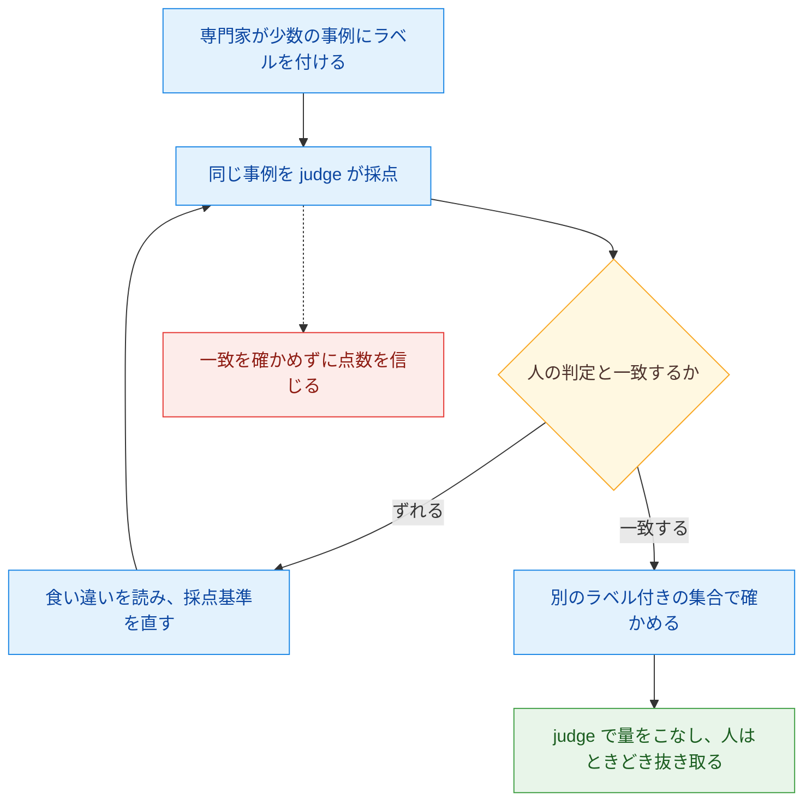

# 人のラベルで較正した LLM-as-judge

> ドメイン: 4. 評価・テスト・デバッグ（10%） ／ 更新: 2026-11-26

!!! abstract "ひとことで"
    LLM の採点者（judge）は、==人のラベルと同じ集合で突き合わせて、判定が一致すること==を確かめてから使う。ずれたら採点基準（rubric）を直して測り直す。judge のモデルや基準、製品が変わったら、もう一度較正する。

## 仕組み

LLM の採点は速くて柔軟だが、それ自体が非決定的で、人の判断とずれうる。だから人の判定を基準にする。まず専門家が少数の事例に合否や点数を付ける。同じ事例を judge に採点させ、一致の度合いと、食い違った事例の中身を見る。食い違いの原因の多くは採点基準のあいまいさにあるので、基準を具体的にして測り直す。一致が十分になったら judge で量をこなし、人の確認はときどきの抜き取りに減らす。

| 採点基準の書き方 | 理由 |
|---|---|
| 合否の条件を具体的に書く（「1文目で製品名に触れなければ不合格」） | あいまいな基準は、judge と人の判断を割る |
| 出力を「合格／不合格」や 1〜5 に絞る | 自由記述の講評は、量をこなして集計できない |
| 観点ごとに judge を分ける | 1つの judge に全部を見させると、どの観点で落ちたか分からない |
| 情報が足りないときの「判断できない」を許す | 逃げ道が無いと、judge が根拠の無い判定をでっち上げる |
| judge に思考（thinking）させてから点を付けさせる | 複雑な判断ほど、採点の精度が上がる |

==生成したモデルと別のモデル==を judge にするのが一般に良いとされる。較正に使った事例だけで一致を確かめると、基準がその事例に合わせ込まれているかもしれない。だから、直した基準は別のラベル付きの事例でも確かめる（推論）。

??? info "細かい決まり・未確認のこと"
    - 公式ドキュメントの採点の順位は、コード ＞ LLM ＞ 人。LLM の採点は「先に信頼性を確かめてから、規模を広げる」
    - エンジニアリングブログ: model-based の採点は、非決定的でコストが高く、人の採点者による較正が要る。人の採点は、品質の基準であり、model-based の採点の較正に使う
    - 一致を測る指標（一致率、κ係数など）や、どれだけ一致すれば足りるかの数値は、公式ドキュメントで確認できなかった（未確認）
    - 長い回答を高く付ける、提示の順番に引きずられる、といった judge の偏りは一般に知られるが、公式ドキュメントでは確認できなかった（未確認）
    - judge の点数を同じ judge の前回の点数と比べても、人とのずれは分からない。較正の基準は人のラベルだ（推論）

## 試験での見分け方

| 問われること | ○ 正しい | × ひっかけ |
|---|---|---|
| judge を信じてよいか | 人のラベル付きの集合で一致を確かめてから使う | より大きなモデルを judge にしたので、そのまま信じる |
| 一致しないとき | 食い違った事例を読み、採点基準を具体的にする | judge と人の点数を平均して使う |
| 基準の形 | 観点ごとに分け、出力を合否か段階に絞る | 「品質を 1〜10 で」の1問で全部を見る |
| 較正のやり直し | judge のモデル・基準・製品が変わったら、人と突き合わせ直す | 前回の較正が済んでいるので、そのまま使い続ける |

## 確認問題

**Q1.** 法務部向けに、契約書の要約を作る機能がある。LLM の judge が「要約が正確か」を合否で採点していて、合格率は 92% だ。弁護士が無作為に 50 件を読むと、使える要約は 35 件（70%）だった。次にすべきこととして最も適切なものはどれか。（1つ選べ）
{ .quiz-q }

- A. judge をより上位のモデルに替え、合格率がどう変わるかを見て、そのまま採用する
- B. judge の合格率と弁護士の合格率を平均した値を、今後の品質の指標にする
- C. 50 件の judge と弁護士の判定を突き合わせ、食い違いの原因から採点基準を直して測り直す
- D. judge をやめ、参照の要約との ROUGE-L で採点するように切り替える

??? success "答えと解説"
    **正解: C。** 人の判定とのずれは、食い違った事例を読んで基準を直し、一致を測り直して埋める。

    - A: モデルを替えても、人と一致するかは確かめていない。較正を飛ばしている
    - B: ずれた judge の点数を混ぜても、ずれは直らない
    - D: 文の重なりは、法的に正確かを測らない。判断の要る観点には向かない

**Q2.** 社内検索の回答を採点する judge のプロンプトは「この回答の品質を 1〜10 で評価せよ。点数だけを出力せよ」の1文だけだ。人のラベルとの一致は低い。プロンプトの直し方として適切なものはどれか。（2つ選べ）
{ .quiz-q }

- A. 点数のぶれを減らすため、思考を止め、すぐに点数だけを出させる
- B. 「出典に沿っているか」「質問に答えているか」を分け、観点ごとに合否の条件を書いた judge を用意する
- C. 意図をよく分かっているよう、回答を生成したモデルと同じモデル・同じプロンプトで採点させる
- D. 細かな条件はかえって縛るので、基準は書かずに judge の自由な講評を返させる
- E. 根拠が足りず判断できないときは「判断できない」と返してよいと、選択肢に加える

??? success "答えと解説"
    **正解: B と E。** 観点を分けて条件を具体的に書き、判断できないときの逃げ道を与える。

    - A: 公式ドキュメントは逆で、思考させてから点を付けさせると精度が上がるとしている
    - C: 生成したモデルとは別のモデルを judge にするのが一般に良いとされる
    - D: 自由記述は集計できず、人との一致も測れない

**Q3.** 2月に、問い合わせ回答の judge を人のラベル 300 件で較正し、高い一致を確かめた。その後、judge のモデルを新しいものに替えた。製品にも「返金の手続きの案内」という新しい回答の型が加わった。judge の点数の扱いとして最も適切なものはどれか。（1つ選べ）
{ .quiz-q }

- A. 新しい型の事例にも人がラベルを付けて集合に加え、新しい judge と人の一致を測り直してから使う
- B. 採点基準の文面は変えていないので、2月の較正の結果をそのまま有効とみなす
- C. 同じ事例を旧 judge と新 judge で採点し、点数が近ければ較正が済んだとみなす
- D. 新しい judge は判定が厳しくなるかもしれないので、合格の線を下げてから使う

??? success "答えと解説"
    **正解: A。** judge のモデルも、採点する対象も変わった。人のラベルと突き合わせ直す。

    - B: 基準が同じでも、モデルが変われば判定は変わりうる。新しい型の事例はそもそも較正していない
    - C: 比べる相手が旧 judge では、人とのずれは分からない
    - D: 一致を確かめずに線を動かすのは、根拠の無い調整だ

## 出典
- Claude Certified Developer – Foundations Exam Guide v1.1, Domain 4 Evaluation Design（公式、PDF）: https://cc.sj-cdn.net/instructor/6nizmqk8tpzpfjvt6qmmav7rh/public/1794946771/Claude_Certified_Developer_-_Foundations_Exam_Guide_Updated_Dec_7.pdf
- [Define success criteria and build evaluations](https://platform.claude.com/docs/en/test-and-evaluate/develop-tests)（公式。Grade your evaluations、Tips for LLM-based grading）
- [Demystifying evals for AI agents](https://www.anthropic.com/engineering/demystifying-evals-for-ai-agents)（公式、エンジニアリングブログ）
