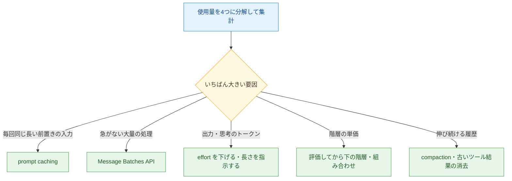

# コストの要因の特定と最適化（バッチ・トークンの予算・効果の見積もり）

> ドメイン: 5. モデルの選択と最適化（12%） ／ 更新: 2026-11-26

!!! abstract "ひとことで"
    まず使用量のデータを分解し、==いちばん大きいコストの要因==を特定する。その要因に効く手段だけを選び、効果を数字で見積もる。効かない要因に手を打っても、請求額はほとんど動かない。

## 仕組み

1回のリクエストの料金は、キャッシュされない入力、キャッシュへの書き込み、キャッシュからの読み込み、出力（思考を含む）の4つに分かれる。それぞれに階層ごとの単価がかかる。使用量の `usage` を集計して、どの部分が請求の大半を占めるかを先に見る。要因が分かれば、手段はほぼ決まる。

| 手段 | 効く要因 | 効かない・注意すること |
|---|---|---|
| prompt caching | 共通の長い前置き（ツール定義、system、文書）を繰り返し送る入力 | 共通の前置きが無ければ効かない。出力の料金は下がらない |
| Message Batches API | 誰も待っていない大量の処理。キャッシュを含むすべてのトークンが半額 | 結果がすぐ要る処理には使えない |
| effort を下げる | 思考や出力のトークンが多い | 品質が落ちないことを評価で確かめる |
| `max_tokens` を絞る | 暴走した長い出力の上限 | 切れた出力も課金される。足りないと切れて作り直しになる |
| 下の階層・組み合わせ | 単価そのもの | 評価で品質の線を確かめる |

`max_tokens` はリクエスト1回ごとの出力の上限で、エージェントのループ全体の支出は抑えない。セッション全体の上限は、Managed Agents のセッションの予算や、workspace の支出の上限で掛ける。

キャッシュの効果は、倍率から見積もれる。キャッシュしなければ、同じ前置きを n 回送ると 1 × n。5分の書き込みは 1.25 倍、読み込みは 0.1 倍（モデルによりさらに低い）なので、**寿命のうちに1回でも読まれれば元が取れる**（1.25 ＋ 0.1 ＜ 2）。逆に、リクエストの間隔が寿命より長いと毎回書き込みになり、キャッシュしないより 25% 高くつく。1時間の書き込みは 2 倍なので、寿命のうちに2回読まれて元が取れる（推論。公式の倍率からの計算）。

!!! example "見積もりの例（Sonnet 5.5、入力 $2/100万トークン、読み込み 0.05 倍）"
    共通の前置きが 1万トークンで、1時間に 1,000 回、間を空けずに届く。キャッシュしないと、1,000万トークン × $2 で1時間 $20。キャッシュすると、書き込み1回（1万 × 1.25 × $2 ≒ $0.025）と読み込み 999 回（999万 × 0.05 × $2 ≒ $1.00）で、約 $1.02。前置きの入力は約 95% 減る。出力の料金は変わらない。

??? info "数字と細かい決まり（2026-11-26 時点）"
    - Message Batches API: 料金は 50% 引き。1バッチは 10万件か 256 MB の小さい方まで。ほとんどは1時間以内に終わり、24時間で終わらなければ期限切れ（期限切れの分は課金されない）。結果は作成から 29日間取り出せる
    - バッチとキャッシュの割引は重なる。ただしバッチの中のキャッシュの当たりは保証されない（公式では 30〜98%）。共通の前置きを持つリクエストをまとめ、同じ `cache_control` を付け、1時間の寿命を使うと当たりやすい
    - 思考は出力トークンとして課金される。`display: "omitted"` にしても課金は変わらない。思考の量は `usage.output_tokens_details.thinking_tokens` で分かる
    - 公式の勧め: エージェントの仕事では `max_tokens` を 64,000 にする。低い上限は、まだ続いている長いターンを切ってしまい、切れた分も課金される
    - Managed Agents のセッションの予算に達すると `stop_reason: budget_reached` で止まる
    - 失敗したものだけを高い effort で走らせ直すと、確かな合否の判定があれば、常に高い effort で走らせるより安く同じ結果に届くことがある

## 試験での見分け方

| 問われること | ○ 正しい | × ひっかけ |
|---|---|---|
| 夜間の大量処理が高い | Message Batches API に移す | リアルタイムのまま、共通の前置きが無いのにキャッシュを入れる |
| 思考のトークンが出力の大半 | 評価で品質を確かめて effort を下げる | `display: "omitted"` にする。`max_tokens` を小さく切る |
| 前置きの入力が大半 | 前置きを固定してキャッシュする | 階層を下げるだけで済ませる |
| 間隔が寿命より長い | 1時間の寿命にするか、キャッシュをやめる | 5分の寿命のまま、毎回書き込みの割増を払う |

## 確認問題

**Q1.** 分析部門は、毎晩 2万件の顧客の問い合わせを要約し、翌朝のレポートに載せている。リアルタイムの Messages API で1件ずつ送っている。使用量を見ると、入力の 70% は問い合わせごとに違う本文で、共通の前置きは短い。残りの 30% が出力だ。費用を最も大きく下げる手段はどれか。（1つ選べ）
{ .quiz-q }

- A. 結果は翌朝までに揃えばよいので、Message Batches API に移す
- B. 入力が大半を占めるので、各リクエストの末尾に `cache_control` を付ける
- C. 出力を減らすため、`max_tokens` を今の半分に下げる
- D. ストリーミングに切り替え、応答を受け取る時間を短くする

??? success "答えと解説"
    **正解: A。** 誰も待っていない大量の処理で、入力も出力も半額になる。

    - B: 入力の大半は毎回違う本文で、共通の前置きは短い。キャッシュで読み込める部分がほとんど無い
    - C: 要約が途中で切れるおそれがある。切れた分も課金され、作り直しになる
    - D: ストリーミングは受け取り方を変えるだけで、料金は変わらない

**Q2.** データ分析のエージェントで、使用量の大半が出力トークンだった。そのうち 85% は `output_tokens_details.thinking_tokens` だ。仕事の多くは決まった表を引く単純な SQL の作成で、評価では effort を `low` にしても正解率が落ちなかった。最も適切な手段はどれか。（1つ選べ）
{ .quiz-q }

- A. ツール定義とシステムプロンプトにブレークポイントを置き、キャッシュで入力を減らす
- B. 評価の結果を踏まえ、このエージェントの effort を `low` に下げる
- C. 思考を表示しないよう `display: "omitted"` にして、思考のトークンを減らす
- D. `max_tokens` を 300 に下げ、思考が長くなる前に応答を切る

??? success "答えと解説"
    **正解: B。** 要因は思考のトークンだ。思考の量の舵は effort で、品質が保てることも評価で確かめてある。

    - A: 要因は出力で、入力ではない
    - C: 表示を止めても、思考は生成され、同じように課金される
    - D: 本文が出る前に切れるおそれがあり、切れた分も課金される

**Q3.** 多数のテナントが使う SaaS で、各テナントのリクエストに、そのテナント専用の前置き（テナントごとに内容が違う規約と設定を含む system で 8,000 トークン）を Opus 5.5 で送っている。5分の寿命でキャッシュしている。料金についての正しい理解はどれか。（2つ選べ）
{ .quiz-q }

- A. ブレークポイントを1つ置くごとに料金がかかるので、数は少ないほど安い
- B. 5分の書き込みは 1.25 倍なので、寿命のうちに1回でも読まれれば、キャッシュしないより安い
- C. キャッシュが当たると、入力だけでなく出力トークンの料金も下がる
- D. あるテナントのリクエストが約 20分おきなら、そのテナントの前置きは毎回書き込みになり、キャッシュしないより高くつく
- E. キャッシュから読んだトークンはコンテキストウィンドウに数えないので、長い前置きも気にしなくてよい

??? success "答えと解説"
    **正解: B と D。** 書き込みの割増は、寿命のうちに読まれて初めて回収できる。間隔が寿命より長いと、割増だけが残る。キャッシュは同じ組織（Claude API では同じ workspace）のリクエストの間で当たるが、前置きがテナントごとに違うので、ほかのテナントのリクエストはこの前置きを生かし続けない。

    - A: ブレークポイント自体は無料。料金は書き込みと読み込みの量で決まる
    - C: キャッシュが下げるのは、前置きの入力の料金だけだ
    - E: キャッシュしたトークンもウィンドウに数える。変わるのは料金だけ

## 出典
- Claude Certified Developer – Foundations Exam Guide v1.1, Domain 5 Cost Diagnosis and Optimization（公式、PDF）: https://cc.sj-cdn.net/instructor/6nizmqk8tpzpfjvt6qmmav7rh/public/1794946771/Claude_Certified_Developer_-_Foundations_Exam_Guide_Updated_Dec_7.pdf
- [Prompt caching](https://platform.claude.com/docs/en/build-with-claude/prompt-caching)（公式）
- [Batch processing](https://platform.claude.com/docs/en/build-with-claude/batch-processing)（公式）
- [Optimizing for cost and intelligence](https://platform.claude.com/docs/en/about-claude/models/optimizing-for-cost-and-intelligence)（公式）
- [Steering thinking](https://platform.claude.com/docs/en/build-with-claude/thinking-steering-and-cost)（公式。Cost control、Pricing）
- [Models overview](https://platform.claude.com/docs/en/models/overview)（公式）
