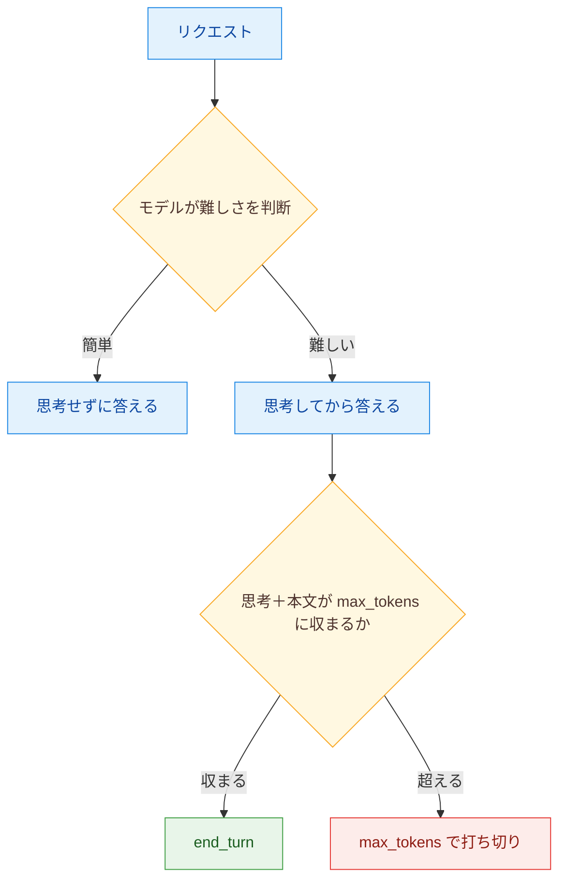

# 生成の仕組みとモデルの選択肢（トークン・コンテキスト・非決定性・adaptive thinking と effort）

> ドメイン: 5. モデルの選択と最適化（12%） ／ 更新: 2026-11-26

!!! abstract "ひとことで"
    出力は確率的に選ばれるので、同じ入力でも毎回同じとは限らない。考えるかどうかと、どれだけ考えるかはモデルが決める（adaptive thinking）。それを ==effort で舵取りし、`max_tokens` で上限を切る==。

## 仕組み

料金も上限も、トークンの数で決まる。コンテキストウィンドウには、system、messages（ツール結果・画像・文書を含む）、ツール定義、そして今回の出力と思考がすべて入る。キャッシュから読んだトークンも数に入る。中身が多いほど良いわけではない。量が増えると、正確さと思い出す力が落ちる（context rot）。

adaptive thinking では、モデルがリクエストごとに入力の難しさを見て、考えるかどうかと、どこまで考えるかを決める。だから同じ会話の中にも、思考のブロックがある応答と無い応答が混ざる。主な舵は effort（`output_config.effort`）だ。effort は思考だけでなく、本文やツール呼び出しも含めた出力全体の量に効く。ただしトークン数を保証する予算ではない。

| 観察した振る舞い | 仕組み | 制御の手段 |
|---|---|---|
| 簡単な仕事で遅く、出力トークンが多い | 思考が多い | effort を下げる（プロンプトで「考えるな」と頼むより確実） |
| 難しい問題で浅い答え | 思考が足りない | effort を上げる |
| 本文が無いまま `max_tokens` で止まる | 思考も `max_tokens` に含まれる | 推論が要る仕事なら上限を上げる。考えすぎなら effort を下げる |
| 同じ入力で答えが変わる | サンプリングによる非決定性 | 指示と例をはっきりさせる。structured outputs で形を固定する。評価は複数回で測る |
| 長い会話で前の内容を落とす | context rot、またはウィンドウの上限 | 要らないものを入れない。compaction を使う |

`temperature` で揺れを抑える手は、使える場面が限られる。API の版 `2023-06-01` なら、Sonnet 4.6 のように既定以外の値を受け付けるモデルでは今も効くが、Claude 4.7 以降のモデルは既定以外の値を 400 で拒む。版 `2026-10-21` では、どのモデルでも `temperature`・`top_p`・`top_k` を送ると、既定値でも 400 になる。**温度に代わる設定は無い**ので、出力の揺れは指示・例・出力の形で抑え、評価で測る。

会話の途中でトップレベルの effort を変えると、プロンプトのキャッシュが無効になりうる。effort の値がプロンプトに書き込まれるからだ。会話の中では effort を固定する。ターンごとに変えたいなら、対応するモデルではメッセージ単位の effort（ベータ）か、メッセージ単位のプロンプトでの舵取りを使う。

??? info "数字と細かい決まり（2026-11-26 時点）"
    - effort の値: `low`・`medium`・`high`・`xhigh`・`max`（モデルにより使える値が違う）。既定は多くのモデルで `high`、Opus 5.5 と Haiku 5.5 は `medium`。既定値を明示しても、省いたのと同じ
    - `adaptive` は思考のモード（`thinking: {"type": "adaptive"}`）で、effort の値ではない
    - Claude 5 以降は思考が既定で有効。Opus 5.5・Fable 5.2 などは `thinking: {"type": "disabled"}` を 400 で拒む。Sonnet 5.5 は `disabled` を拒み、最初の思考を止めるには `between_tools` を使う。Haiku 5.5 は effort `high` 以下なら `disabled` を受け付ける
    - `budget_tokens` で思考の量を決める手動の extended thinking は、Opus 4.6・Sonnet 4.6 で非推奨、それより新しいモデルでは受け付けない（400）。例外は Mythos Preview で、`budget_tokens` を受け付けて extended thinking になる
    - 思考は出力トークンとして課金される。`display: "omitted"` でも `"summarized"` でも課金は同じ。思考に使った量は `usage.output_tokens_details.thinking_tokens` で分かる
    - 前のターンの思考ブロックを残すかはモデルで違う。Opus 4.5 以降の Opus、Sonnet 4.6 以降、Haiku 5.5 などは残し、入力トークンとして数える
    - 入力だけでウィンドウを超えると 400（prompt is too long）。Claude 4.5 以降は、入力＋`max_tokens` が超えても受け付け、上限に達すると `stop_reason: "model_context_window_exceeded"` で止まる
    - 現行の主なモデルのウィンドウは 100万トークン、1回の出力は最大 12.8万トークン。Opus 4.7 から入ったトークナイザーでは、100万トークンが約 55.5万語（それ以前は約 75万語）。同じ文章でもトークン数が増える
    - 事前に数えるには token counting API を使う

## 試験での見分け方

| 問われること | ○ 正しい | × ひっかけ |
|---|---|---|
| 思考を減らしたい | effort を下げる | 「考えずに答えて」とプロンプトに書く。`budget_tokens` を小さくする |
| 本文が無く `max_tokens` で止まる | 思考を含めた上限を見直すか、effort を下げる | 同じリクエストを再試行する |
| 出力を揺らさない | 指示・例・structured outputs と、複数回の評価 | `temperature: 0` を送る |
| ターンごとに考える量を変える | メッセージ単位の effort か、プロンプトで舵取り | トップレベルの effort を毎回変える（キャッシュが効かなくなる） |

## 確認問題

**Q1.** 問い合わせを5種類に分類するサービスを、Opus 5.5 に移した。`max_tokens` は、思考の無かった頃の 1024 のままだ。ときどき、本文のテキストが無いまま `stop_reason: "max_tokens"` で止まる。分類は単純で、評価では `low` の effort でも精度が落ちないと分かっている。最も適切な対応はどれか。（1つ選べ）
{ .quiz-q }

- A. 思考も `max_tokens` に含まれると踏まえ、effort を `low` に下げ、上限にも余裕を持たせる
- B. システムプロンプトに「深く考えずに、すぐ分類だけを答えること」と書き足す
- C. 思考が不要な仕事なので、`thinking: {"type": "disabled"}` を送って思考を止める
- D. 手動の思考の予算として `budget_tokens: 512` を指定し、残りを本文に回す

??? success "答えと解説"
    **正解: A。** 単純な仕事で考えすぎて上限を使い切っている。effort を下げるのが確実な舵で、上限も思考の分を見込む。

    - B: プロンプトでの舵取りは言い回しに左右される。まず effort を下げる
    - C: Opus 5.5 は思考を止められず、`disabled` は 400 になる
    - D: `budget_tokens` は新しいモデルでは受け付けない

**Q2.** Sonnet 4.6 を使う書類の項目抽出で、「毎回同じ結果を出すため」に API の版 `2023-06-01` で `temperature: 0` を送っていた。API の版を `2026-10-21` に上げると、リクエストが 400 で失敗するようになった。対応として適切なものはどれか。（2つ選べ）
{ .quiz-q }

- A. `temperature` を既定値の 1.0 にして送れば、400 は出なくなる
- B. `temperature`・`top_p`・`top_k` をリクエストから外す
- C. `temperature` の代わりに `top_k: 1` を送り、いちばん確率の高いトークンだけを選ばせる
- D. 揺れは指示と例、structured outputs で抑え、複数回走らせた評価で一致の度合いを確かめる
- E. effort を `max` に上げ、毎回同じ答えにたどり着くようにする

??? success "答えと解説"
    **正解: B と D。** Sonnet 4.6 は `2023-06-01` なら既定以外の値を受け付けるが、`2026-10-21` では3つのサンプリングのパラメータはどのモデルでも送れない。温度に代わる設定は無いので、出力の形と評価で揺れを扱う。

    - A: 既定値でも 400 になる
    - C: `top_k` も同じく送れない
    - E: effort は思考と出力の量の舵で、同じ出力を保証するものではない

**Q3.** 調査エージェントのハーネスは、計画のターンでは `output_config.effort` を `high`、確認だけのターンでは `low` に、リクエストごとに切り替えている。使用量を見ると、毎ターン `cache_read_input_tokens` が 0 で、`cache_creation_input_tokens` が大きい。最も適切な直し方はどれか。（1つ選べ）
{ .quiz-q }

- A. キャッシュのブレークポイントを4つに増やし、どこかで読み込みが当たるようにする
- B. キャッシュの寿命を1時間に延ばし、ターンの間に消えないようにする
- C. トップレベルの effort は会話の中で固定し、ターンごとの差はメッセージ単位の effort かプロンプトで付ける
- D. システムプロンプトを messages の先頭に移し、effort の影響を受けないようにする

??? success "答えと解説"
    **正解: C。** effort の値はプロンプトに書き込まれる。変えるたびに前置きが一致しなくなり、キャッシュが外れる。

    - A: 前置きが毎回変わるので、ブレークポイントを増やしても一致しない
    - B: 寿命が切れているのではない。前置きが変わっている
    - D: effort の変更は、少なくとも messages のキャッシュを無効にする。移しても外れる

## 出典
- Claude Certified Developer – Foundations Exam Guide v1.1, Domain 5 Generation Mechanics and Model Options（公式、PDF）: https://cc.sj-cdn.net/instructor/6nizmqk8tpzpfjvt6qmmav7rh/public/1794946771/Claude_Certified_Developer_-_Foundations_Exam_Guide_Updated_Dec_7.pdf
- [Steering thinking](https://platform.claude.com/docs/en/build-with-claude/thinking-steering-and-cost)（公式）
- [Thinking](https://platform.claude.com/docs/en/build-with-claude/thinking)（公式）
- [Effort](https://platform.claude.com/docs/en/build-with-claude/effort)（公式）
- [Context windows](https://platform.claude.com/docs/en/build-with-claude/context-windows)（公式）
- [Migrating to API version 2026-10-21](https://platform.claude.com/docs/en/api/migration-2026-10-21)（公式。Sampling parameters are removed）
- [Model deprecations](https://platform.claude.com/docs/en/about-claude/model-deprecations)（公式。API parameter deprecations）
