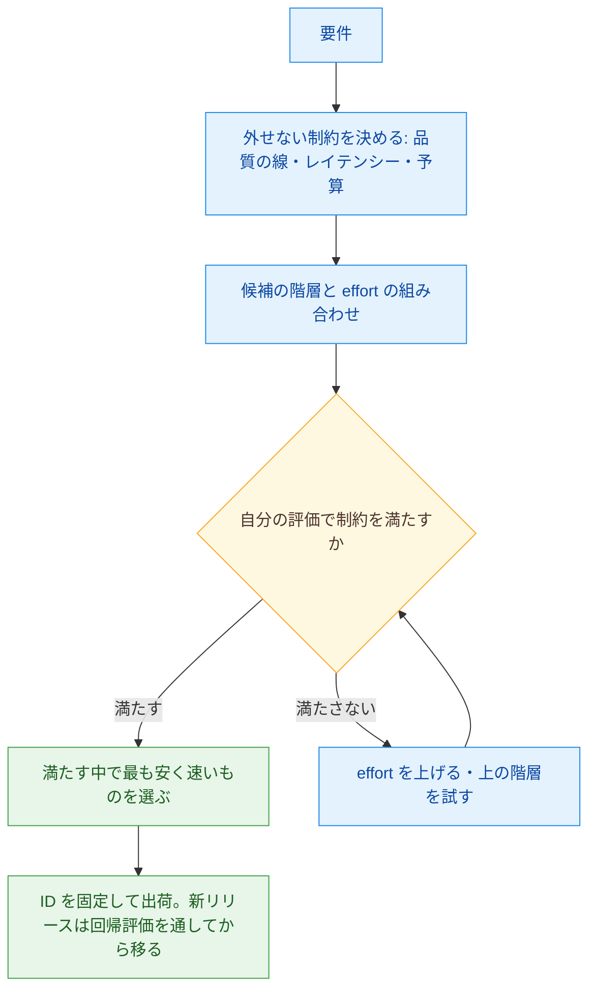

# モデルの階層の選択と、リリースをまたぐ変化への備え

> ドメイン: 5. モデルの選択と最適化（12%） ／ 更新: 2026-11-26

!!! abstract "ひとことで"
    階層は、要件の中で==外せない制約（binding constraint）==を先に決め、それを満たす候補を自分の評価で比べて選ぶ。モデル ID は固定のスナップショットなので、新しいリリースへは回帰評価を通してから移る。

## 仕組み

品質・レイテンシー・コストのどれが外せない制約かで、選び方が変わる。p95 の応答時間に上限があるなら、それを超える階層は品質が高くても候補から外れる。品質の線が外せないなら、線を満たす中でいちばん安く速いものを選ぶ。比べる材料は、公開のベンチマークでなく、自分のプロンプトとデータで作った評価だ。同じモデルの中でも effort で品質・速さ・コストを動かせるので、モデルを替える前に effort を変えてみる方が効くことが多い。

| 階層（2026-11 の現行） | 向く仕事 |
|---|---|
| Fable 5.2 | 最も高い能力が要る仕事。何時間も続くエージェント、多段の調査 |
| Opus 5.5 | 複雑なエージェント的コーディングと業務。迷ったらここから |
| Sonnet 5.5 | 速さと能力の両方が要る日常のコーディング・エージェント・分析 |
| Haiku 5.5 | 最も低いレイテンシーと価格。リアルタイム、大量の分類・抽出・振り分け、サブエージェント |

始め方は2つある。効率から始めるなら、Haiku で作って評価し、足りないところだけ上げる。試作・厳しいレイテンシー・大量で単純な仕事に向く。能力から始めるなら、Opus で作ってプロンプトを詰め、effort を下げるか階層を下げて効率を上げる。安いモデルと上位のモデルを組み合わせる手もある（上位のモデルが計画し、安いワーカーが大量の作業をする、など）。

リリースへの備えの土台は、**モデル ID が固定のスナップショットだ**ということだ。4.6 世代以降の日付の無い ID（`claude-opus-5-5` など）も、最新版を指す別名ではなく、それ自体がスナップショットだ。新しい版は新しい ID で出る。ただし周りの配信の仕組み（ルーター、安全の分類器、サンプリングの処理）は変わることがあり、同じ ID でも振る舞いがわずかに変わりうる。だから回帰評価は移行のときだけでなく、定期的にも回す。

??? info "数字と細かい決まり（2026-11-26 時点）"
    - 料金（入力/出力、100万トークンあたり）: Fable 5.2 $8/$40、Opus 5.5 $4/$20、Sonnet 5.5 $2/$10、Haiku 5.5 $0.10/$0.50 から。レイテンシーの比較は Fable・Opus が中程度、Sonnet が速い、Haiku が最速
    - 4つとも、コンテキスト 100万トークン、最大出力 12.8万トークン、思考は adaptive（Fable 5.2・Opus 5.5 は常に有効）。effort の既定は Fable・Sonnet が `high`、Opus 5.5・Haiku 5.5 が `medium`
    - 4.6 世代より前の ID には日付が付く（例: `claude-haiku-4-5-20251001`）。4.5 の短い別名（`claude-haiku-4-5`）は、その版の最新の日付付きスナップショットを指す
    - ライフサイクル: Active → Legacy → Deprecated（動くが非推奨。後継と引退日が示される）→ Retired（使えない）。公開モデルの引退は、少なくとも 60 日前に通知される。引退したモデルへのリクエストは、Claude API では 404 `not_found_error` で失敗する
    - Console の Usage ページから CSV を書き出すと、API キー別・モデル別の利用が分かり、非推奨のモデルを使っている箇所を探せる
    - 移るときは、前のモデルの effort の設定を持ち越さず、自分の評価で effort を振り直す（各モデルの推奨）。breaking changes（prefill が使えない、思考を止められない、サンプリングのパラメータが送れない、など）も確かめる
    - Bedrock と Google 管理の Google Cloud は、引退の日程を独自に決める

## 試験での見分け方

| 問われること | ○ 正しい | × ひっかけ |
|---|---|---|
| 階層の決め方 | 外せない制約を決め、自分の評価で満たす中の最安・最速を選ぶ | 公開ベンチマークの順位や「上位なら安全」で決める |
| 品質は足りるがコストが高い | まず effort を下げ、評価で品質を確かめる | 評価をせずに一段下の階層に替える |
| 日付の無い ID | 固定のスナップショットとして扱う | 最新版に自動で切り替わる別名とみなす |
| 引退の通知 | 後継で回帰評価を回し、effort を振り直してから ID を替える | 引退日に ID だけ書き換える。404 を再試行で凌ぐ |
| 同じ ID で振る舞いが変わった | 配信の仕組みの変化を疑い、定期の回帰評価で検知する | 重みが黙って更新されたと決めつける |

## 確認問題

**Q1.** コールセンターで、通話の書き起こしを受けて担当窓口を選ぶ振り分け機能を作っている。要件は p95 の応答時間 800 ms 以内と、振り分けの正解率 95% 以上。自社の評価では、Opus 5.5（`low`）が正解率 97%・p95 1,400 ms、Haiku 5.5（`medium`）が正解率 96%・p95 600 ms だった。選ぶべき構成として最も適切なものはどれか。（1つ選べ）
{ .quiz-q }

- A. 正解率がより高いので、Opus 5.5 を `low` のまま使う
- B. 両方の要件を満たすので、Haiku 5.5 を `medium` で使う
- C. 正解率を上げるため、Haiku 5.5 を `max` にして使う
- D. 品質を優先し、Fable 5.2 に替えて正解率をさらに上げる

??? success "答えと解説"
    **正解: B。** 外せない制約は p95 800 ms と正解率 95%。両方を満たすのは Haiku 5.5 だけだ。

    - A: 正解率は高いが、レイテンシーの制約を満たさない
    - C: 正解率の線はすでに満たしている。effort を上げれば遅く高くなり、制約を外れうる
    - D: 品質の線は満たしている。上位の階層はレイテンシーとコストを悪くする

**Q2.** 社内検索のアプリが使っているモデルに、非推奨の通知が来た。引退日は 60 日後で、後継のモデルが示されている。アプリはそのモデルの ID を固定で指定している。対応として最も適切なものはどれか。（1つ選べ）
{ .quiz-q }

- A. ID を指定していれば、引退後は後継のモデルに自動で切り替わるので、何もしない
- B. 引退日の当日に、ID を後継のモデルに書き換えて出荷する
- C. 引退後に返る 404 を検知して、後継のモデルで再試行する処理を足しておく
- D. 後継のモデルで回帰評価を回し、effort を振り直して breaking changes に対応してから ID を替える

??? success "答えと解説"
    **正解: D。** 引退したモデルへのリクエストは失敗する。後継は、自分の評価で確かめてから使う。

    - A: 自動で切り替わる仕組みは無い。引退後のリクエストは 404 で失敗する
    - B: 確かめていない後継を、いきなり本番に出すことになる
    - C: 確かめていない後継に本番を任せる点は B と同じで、失敗を前提にした設計でもある

**Q3.** 文書の抽出パイプラインは `claude-sonnet-5-5` を固定で使っている。コードもプロンプトも変えていないのに、先月と比べて抽出の結果がわずかに違う事例が見つかった。正しい理解はどれか。（2つ選べ）
{ .quiz-q }

- A. 日付の無い ID は最新版を指す別名なので、新しい版に切り替わった
- B. Anthropic は既存の ID の重みを予告なく更新するので、その更新が原因だ
- C. ID の重みは固定だが、配信の仕組みの変化で振る舞いがわずかに変わることがある
- D. 日付の付いた ID を指定し直せば、配信の仕組みの変化も含めて振る舞いを固定できる
- E. 変化を早く見つけるため、回帰評価を移行のときだけでなく定期的にも回す

??? success "答えと解説"
    **正解: C と E。** ID は固定のスナップショットだが、配信の仕組みは変わりうる。だから回帰評価で見張る。

    - A: 4.6 世代以降の日付の無い ID は、それ自体がスナップショットで、別名ではない
    - B: 既存の ID の重みや設定は更新されない。新しい版は新しい ID で出る
    - D: 配信の仕組みは ID の外にある。どの ID でも影響を受けうる

## 出典
- Claude Certified Developer – Foundations Exam Guide v1.1, Domain 5 Model Tier Selection and Release Planning（公式、PDF）: https://cc.sj-cdn.net/instructor/6nizmqk8tpzpfjvt6qmmav7rh/public/1794946771/Claude_Certified_Developer_-_Foundations_Exam_Guide_Updated_Dec_7.pdf
- [Choosing the right model](https://platform.claude.com/docs/en/about-claude/models/choosing-a-model)（公式）
- [Models overview](https://platform.claude.com/docs/en/models/overview)（公式）
- [Model IDs and versioning](https://platform.claude.com/docs/en/about-claude/models/model-ids-and-versions)（公式）
- [Model deprecations](https://platform.claude.com/docs/en/about-claude/model-deprecations)（公式）
- [Effort](https://platform.claude.com/docs/en/build-with-claude/effort)（公式）
