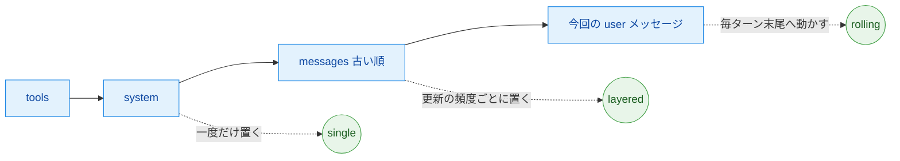

# prompt caching のブレークポイントの置き方（single・layered・rolling）

> ドメイン: 5. モデルの選択と最適化（12%） ／ 更新: 2026-11-26

!!! abstract "ひとことで"
    キャッシュが効くのは、==先頭から `cache_control` を付けたブロックまでが、前回と完全に一致する前置き==だけだ。変わらないものを前に、変わるものを後ろに並べ、最後の安定したブロックにブレークポイントを置く。

## 仕組み

前置きは `tools` → `system` → `messages` の順に組み立てられる。キャッシュの鍵は、そこからブレークポイントまでの中身のハッシュだ。だから前の方に1文字でも変わる部分（時刻、利用者ごとの値）があると、その後ろはすべて一致しない。書き込みはブレークポイントの位置でだけ起きる。読み込みは、ブレークポイントから最大 20 ブロック前までさかのぼって、前のリクエストが書いた入口を探す。

| 置き方 | いつ使う | 置く場所 |
|---|---|---|
| single | 固定の前置きの後に、毎回変わる部分が続く | 固定の前置きの最後のブロック。たいていはこれ1つで足りる |
| layered | 更新の頻度が違う部分が並ぶ | 変わりにくいものほど前に置き、それぞれの末尾に置く |
| rolling | 会話やエージェントのループで履歴が伸びる | 毎ターン、最新のメッセージの最後のブロック。またはトップレベルの `cache_control`（自動キャッシュ）で末尾に自動で動かす |

効いているかは、応答の `usage` で読む。`cache_creation_input_tokens` は今回キャッシュに書いた量、`cache_read_input_tokens` は読んだ量、`input_tokens` は最後のブレークポイントより後ろの、キャッシュされない量だ。入力の合計は3つの和になる。毎回 creation だけが大きく read が 0 なら、前置きが毎回変わっている。両方 0 なら、そもそもキャッシュされていない。最小の長さに足りないことが多い。

前置きを変えてしまう操作にも気をつける。ツール定義を変えると、すべてが無効になる。`tool_choice` や画像の有無を変えると、system と messages が無効になる。思考の設定やトップレベルの effort を変えると、少なくとも messages が無効になる。

??? info "数字と細かい決まり（2026-11-26 時点）"
    - 明示のブレークポイントは最大 4 つ。自動キャッシュを併用すると、そのうち1つを使う。4つ置いたうえで自動キャッシュを足すと 400。ブレークポイント自体は無料
    - 自動キャッシュは Bedrock の `bedrock-runtime` では使えない（400）。明示のブレークポイントを使う
    - 寿命: 既定 5分。当たるたびに無料で延びる。1時間は `"cache_control": {"type": "ephemeral", "ttl": "1h"}`。混ぜるときは、1時間の入口を5分の入口より前に置く
    - 料金の倍率（基本の入力単価に対して）: 5分の書き込み 1.25 倍、1時間の書き込み 2 倍、読み込み 0.1 倍。読み込みは Opus 5.5・Sonnet 5.5 で 0.05 倍、Fable 5.2・Fable 5.1 などで 0.025 倍
    - 最小の長さ: Opus 5.5・Sonnet 5.5・Haiku 5.5 などは 512 トークン。Sonnet 5・Opus 4.8 などは 1,024、Opus 4.7 は 2,048、Opus 4.6・Haiku 4.5 は 4,096。足りないとエラーは出ず、キャッシュされずに処理される
    - さかのぼりは 20 ブロックまで（ブレークポイント自身が1つ目）。1ターンで 20 ブロック以上増えるなら、2つ目のブレークポイントを手前に置く。Claude API では、連続する `tool_use` は1つの位置、連続する `tool_result` も1つの位置として数える
    - 入口が使えるのは、最初の応答が始まってから。並列のリクエストを当てたいなら、1件目の応答を待ってから残りを送る
    - キャッシュは組織の間で共有されない。プラットフォームによっては workspace の間でも分かれる。手動で消す方法は無い
    - キャッシュしたトークンもコンテキストウィンドウに数える。変わるのは料金だけ

## 試験での見分け方

| 問われること | ○ 正しい | × ひっかけ |
|---|---|---|
| read が毎回 0、creation が毎回大きい | 前置きの中の変わる値（時刻など）を、ブレークポイントの後ろへ移す | 寿命を1時間に延ばす。ブレークポイントを増やす |
| 会話が伸びても履歴が読まれない | 最新のメッセージの末尾にブレークポイントを動かす（rolling） | system にだけ置いたまま。全メッセージに付けようとする |
| creation も read も 0 | 最小の長さに足りないと見る | 書式の誤りや、組織の設定でキャッシュが無効だと疑う |
| 並列で一斉に送ると当たらない | 1件目の応答が始まってから残りを送る | ブレークポイントの位置を変える |

## 確認問題

**Q1.** 社内の規程を答えるアシスタントで、システムプロンプトは「現在時刻: 2026-11-26T10:31:05Z」の1行から始まり、その後に 6,000 トークンの指示が続く。`cache_control` はシステムプロンプトの最後のブロックに付けた。使用量は毎回 `cache_creation_input_tokens: 6020`、`cache_read_input_tokens: 0` だ。最も適切な直し方はどれか。（1つ選べ）
{ .quiz-q }

- A. キャッシュの寿命を `"ttl": "1h"` に延ばし、次のリクエストまで入口が残るようにする
- B. ブレークポイントを4つに増やし、システムプロンプトのあちこちに置く
- C. 現在時刻の行をブレークポイントより後ろ（user メッセージなど）へ移し、前置きを毎回同じにする
- D. 最小の長さに足りていないとみて、システムプロンプトに説明を足して長くする

??? success "答えと解説"
    **正解: C。** 先頭の時刻が毎回変わるので、ハッシュが一致しない。変わる値は前置きの外へ出す。

    - A: 寿命の問題ではない。前置きが毎回違うので、残っていても当たらない
    - B: どのブレークポイントの前にも時刻の行がある。どれも一致しない
    - D: creation が 6,020 と出ているので、書き込みは起きている。長さは足りている

**Q2.** コーディング支援のエージェントは、ツール定義と system の末尾にだけブレークポイントを置いている。ターンが進むと、`cache_read_input_tokens` は固定の分のまま増えない。`input_tokens` は会話の長さに比例して増え続ける。1ターンで増えるブロックが 20 を超えることもある。直し方として適切なものはどれか。（2つ選べ）
{ .quiz-q }

- A. 毎ターン、最新のメッセージの最後のブロックに `cache_control` を置くか、トップレベルの自動キャッシュを使う
- B. 履歴のすべてのメッセージに `cache_control` を付け、どれかが当たるようにする
- C. 最初の user メッセージにブレークポイントを置き、会話の冒頭を固定でキャッシュする
- D. 寿命を1時間に延ばし、伸びた履歴が消えずに残るようにする
- E. 1ターンで 20 ブロック以上増えるときは、前回の書き込みの近くに2つ目のブレークポイントを置く

??? success "答えと解説"
    **正解: A と E。** 伸びる履歴には rolling で置く。さかのぼりは 20 ブロックまでなので、増え方が大きいときは手前にもう1つ置く。

    - B: 明示のブレークポイントは最大4つ。全部には付けられない
    - C: 冒頭は固定でも、その後ろに伸びる履歴は毎回キャッシュされない
    - D: 履歴の部分はそもそも書き込まれていない。寿命を延ばしても読む入口が無い

**Q3.** 問い合わせの短い分類に Haiku 5.5 を使っている。システムプロンプトは約 300 トークンで、末尾に `cache_control` を付けた。使用量は毎回 `cache_creation_input_tokens: 0`、`cache_read_input_tokens: 0`、`input_tokens: 380` だ。この状態の説明として最も適切なものはどれか。（1つ選べ）
{ .quiz-q }

- A. `cache_control` の書き方が誤っていて、`"type": "persistent"` を指定する必要がある
- B. 組織の設定でキャッシュが無効になっているので、Console で有効にする必要がある
- C. 1回目のリクエストなので読み込みが 0 なのは正常で、2回目から read が出る
- D. 前置きがこのモデルの最小の長さに足りないので、エラーは出ずにキャッシュされずに処理されている

??? success "答えと解説"
    **正解: D。** Haiku 5.5 の最小は 512 トークン。足りないとキャッシュされず、エラーも出ない。両方の値が 0 になる。

    - A: 種類は `ephemeral` だけだ
    - B: 組織の設定の問題ではない。長さの条件で説明がつく
    - C: 書き込みが起きていれば、1回目でも creation が 0 より大きくなる

## 出典
- Claude Certified Developer – Foundations Exam Guide v1.1, Domain 5 Cost Diagnosis and Optimization（公式、PDF）: https://cc.sj-cdn.net/instructor/6nizmqk8tpzpfjvt6qmmav7rh/public/1794946771/Claude_Certified_Developer_-_Foundations_Exam_Guide_Updated_Dec_7.pdf
- [Prompt caching](https://platform.claude.com/docs/en/build-with-claude/prompt-caching)（公式）
- [Steering thinking](https://platform.claude.com/docs/en/build-with-claude/thinking-steering-and-cost)（公式。Prompt caching）
- [Context windows](https://platform.claude.com/docs/en/build-with-claude/context-windows)（公式）
