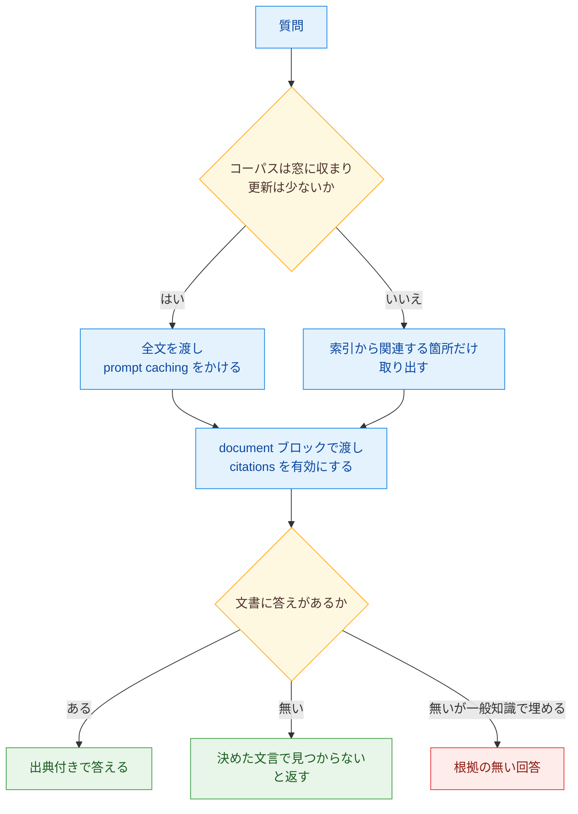

# 渡した文書にもとづく回答と出典

> ドメイン: 6. プロンプトとコンテキストのエンジニアリング（15%） ／ 更新: 2026-11-26

!!! abstract "ひとことで"
    渡した文書だけを根拠に答えさせ、出典は citations 機能で返させ、==文書に答えが無いときは決めた文言で「見つからない」と返させる==。全文を渡すか検索で一部を渡すかは、コーパスの大きさ・コスト・鮮度で決める。

## 仕組み

根拠づけ（grounding）のリクエストは3つの部品でできる。文書を `document` ブロックで渡して `citations.enabled: true` にする。指示で「渡した文書の情報だけを使う」と範囲を絞る。答えが無いときの返し方を決めた文言で許す。「分からない」と言ってよいと明示しないと、モデルは一般知識でもっともらしく埋めやすい。

| 観点 | 全文をコンテキストに入れる | 関連箇所だけ検索して渡す |
|---|---|---|
| コーパスの大きさ | 窓に十分収まる | 窓を超える、または大半が毎回無関係 |
| コスト | 毎回全文の入力。固定部分は prompt caching で安くできる | 入力は小さいが、索引と検索の仕組みを持つ |
| 鮮度 | 更新のたびにキャッシュが作り直しになる（推論） | 更新を索引に反映すれば、すぐ答えに出る |
| 失敗の型 | 長い入力で関連箇所を拾い損ねる | 検索が正しい箇所を取り損ねる |

citations 機能は、プロンプトで「引用せよ」と頼むより確かだ。API が応答を解析し、引用が渡した文書の実在の位置を指すことが保証される。引用の無い主張は、根拠の無い主張として扱えばよい（推論）。==文書の更新日や部署のようなメタデータ==は、本文に混ぜず `title` や `context` に置く。この2つはモデルに渡るが、引用の対象にならない。

??? info "citations の細かい決まり（2026-11 時点）"
    - 文書の種類と引用の位置: プレーンテキストは文単位に分割され、文字位置（`char_location`、0始まり、終わりは含まない）。PDF は文単位で、ページ番号（`page_location`、1始まり）。custom content は渡したブロックのまま分割せず、ブロックの番号（`content_block_location`、0始まり）
    - 箇条書きや書き起こしのように引用の粒度を自分で決めたいときは custom content を使う。RAG のチャンクを文単位で引用させたいなら、チャンクごとにプレーンテキストの文書にする
    - 1つのリクエストで、citations を有効にした文書と無効の文書は混ぜられない。画像は引用できない。`search_result` ブロックも引用の対象にできる
    - `cited_text` は出力トークンに数えない。次のターンで送り返しても入力トークンに数えない。有効にすると、システムプロンプトの追加と分割のぶん入力はわずかに増える
    - 応答の引用ブロックはキャッシュできないが、元の文書には `cache_control` を付けられる
    - 構造化出力（`output_config.format`）とは併用できず、400 エラー。「JSON だけを返せ」と頼むと、引用が少なくなるか無くなる
    - 長い文書（20k トークン超）では、まず関連する引用を抜き出させてから答えさせる。引用が見つからなければ「No relevant quotes found」のように返させる、という例が公式にある
    - コーパスが 200,000 トークン（約500ページ）より小さければ、RAG を使わず全文をプロンプトに入れられる、と Anthropic の 2024-09 の記事にある。いまの窓の大きさでの目安は未確認。多くの現行モデルの窓は 1M トークンと、Claude Code のベストプラクティスにある

## 試験での見分け方

| 問われること | ○ 正しい | × ひっかけ |
|---|---|---|
| 文書に無い質問にもっともらしく答える | 文書だけを根拠にさせ、無ければ決めた文言で返させる | 「正確に答えよ」と強調するだけ |
| 出典を確実に付けたい | citations 機能を有効にする | プロンプトで「引用を付けよ」と頼み、文面を信じる |
| 小さく更新の少ないマニュアル | 全文を渡し、prompt caching をかける | 小さくても必ず埋め込み検索を組む |
| 大きく毎日変わる規程集 | 索引から関連箇所を取り出し、更新を索引に反映する | 全文を月1回まとめてプロンプトに焼き込む |
| メタデータが引用に混ざる | `context` や `title` に移す | プロンプトで「メタデータを引用するな」と頼む |

## 確認問題

**Q1.** 社内の人事規程に答えるボットに、規程の文書を渡している。規程に書かれていない介護休暇の質問に、ボットは一般的な法律の知識で、もっともらしい日数を答えた。その回答には引用が1つも付いていなかった。最も適切な改訂はどれか。（1つ選べ）
{ .quiz-q }

- A. システムプロンプトに「正確に、慎重に答えること」と書き足す
- B. Web 検索のツールを足し、規程に無い情報は一般の情報で補わせる
- C. 渡した規程だけを根拠にさせ、記載が無ければ「規程に記載がありません」と返させる
- D. すべての回答の末尾に「法的助言ではありません」という注記を付ける

??? success "答えと解説"
    **正解: C。** 根拠の範囲を文書に絞り、答えが無いときの返し方を許すのが、根拠の無い回答への手当てだ。

    - A: 「分からない」と言ってよいことも、根拠の範囲も示していない
    - B: 社内規程の質問に、規程でない情報で答える経路を増やすことになる
    - D: 根拠の無い回答はそのまま出る。注記は症状を隠すだけ

**Q2.** 2つのコーパスで根拠づけの回答を作る。製品マニュアルは約 30,000 トークンで、四半期に1回更新され、1日に数千件の質問が来る。法令と社内規程の集まりは約 3,000,000 トークンで、毎日更新される。設計として適切なものはどれか。（2つ選べ）
{ .quiz-q }

- A. マニュアルは全文をコンテキストに入れ、prompt caching をかける
- B. 規程集も全文を毎回コンテキストに入れ、検索の仕組みは持たない
- C. 規程集は索引から関連する節だけを取り出して渡し、毎日の更新を索引に反映する
- D. マニュアルも、小さくても埋め込み検索で関連箇所だけを渡さないと出典を付けられない
- E. 規程集は月1回まとめてシステムプロンプトに入れ直し、その間の更新は待つ

??? success "答えと解説"
    **正解: A と C。** 小さく変わらないものは全文とキャッシュで、大きく変わるものは検索で渡す。

    - B: 窓に収まる量を超えるうえ、毎回の入力が膨大になる
    - D: 全文を `document` ブロックで渡しても citations は使える。検索は必須でない
    - E: 毎日の更新が最大1か月、答えに出ない

**Q3.** citations を有効にした社内文書の検索で、各文書の本文の先頭に「部署: 人事部 / 更新日: 2026-10-01」という行を入れている。モデルに更新日を見て新しい文書を優先させたいからだ。ところが、回答の引用にその行がたびたび含まれる。最も適切な直し方はどれか。（1つ選べ）
{ .quiz-q }

- A. その行を本文から外し、`document` ブロックの `context` フィールドに移す
- B. メタデータだけを別の文書にし、その文書だけ citations を無効にする
- C. システムプロンプトに「部署や更新日の行は引用しないこと」と書き足す
- D. citations を無効にし、出典はプロンプトで文書名を書かせて付ける

??? success "答えと解説"
    **正解: A。** `context` はモデルに渡るが引用の対象にならないので、更新日を見せたまま引用から外せる。

    - B: citations を有効にした文書と無効の文書は、1つのリクエストで混ぜられない
    - C: 本文の中にある限り引用の対象で、指示では確実に防げない
    - D: 引用が実在の位置を指すという保証を失う

## 出典
- Claude Certified Developer – Foundations Exam Guide v1.1（Dec 7 版）, Domain 6: Grounding and Source Citation（公式、PDF）: https://cc.sj-cdn.net/instructor/6nizmqk8tpzpfjvt6qmmav7rh/public/1794946771/Claude_Certified_Developer_-_Foundations_Exam_Guide_Updated_Dec_7.pdf
- [Citations](https://platform.claude.com/docs/en/build-with-claude/citations)（公式）
- [Reduce hallucinations](https://platform.claude.com/docs/en/test-and-evaluate/strengthen-guardrails/reduce-hallucinations)（公式）
- [Prompting best practices](https://platform.claude.com/docs/en/build-with-claude/prompt-engineering/claude-prompting-best-practices)（公式、Long context prompting の節）
- [Best practices for Claude Code](https://code.claude.com/docs/en/best-practices)（公式、窓の大きさの記述）
- [Introducing Contextual Retrieval](https://www.anthropic.com/news/contextual-retrieval)（公式、2024-09-19）
