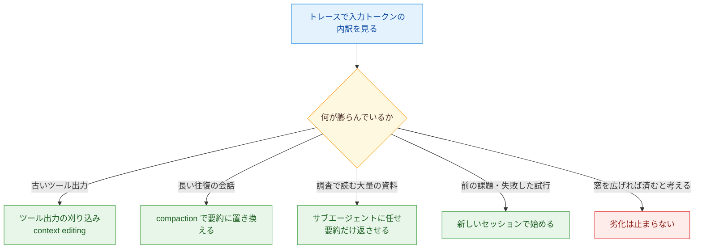

# 長いセッションのコンテキスト管理

> ドメイン: 6. プロンプトとコンテキストのエンジニアリング（15%） ／ 更新: 2026-11-26

!!! abstract "ひとことで"
    長いセッションの劣化は、==何がコンテキストを埋めているか==を見て直す。古いツール出力なら刈り込み、会話の流れが要るなら compaction、読む量が多い調査はサブエージェントに分け、課題が変わったら新しいセッションにする。

## 仕組み

コンテキストは大きいほど良いわけではない。トークンが増えるほど、モデルが古い情報や無関係な情報に引きずられ、最初に決めた振る舞いからずれていく（context rot）。だから「窓が足りないから広げる」ではなく、中身を減らして、残す情報を選ぶ。どの手法を選ぶかは、膨らみの原因で決まる。

| 手法 | 向く場面 | 失うもの |
|---|---|---|
| ツール出力の刈り込み | 検索やログ取得の結果が古いまま溜まっている | 消した結果の中身（直近の数件は残せる） |
| compaction | 長い往復で、合意や経緯を引き継ぎたい | 要約に入らなかった細部、要約範囲の画像や文書 |
| サブエージェントでの分離 | 大量に読むが、本流に要るのは結論だけ | サブエージェントが読んだ生の資料 |
| 新しいセッション | 別の課題に移る、同じ修正が2回失敗した | 履歴のすべて（要る情報はファイルなどで渡す） |

ツール出力の刈り込みは、最も軽い手当てだ。会話そのものは残るので、まずこれを考える。compaction は会話を要約に置き換えるので、==要約に何を残すか==を決めておかないと、後の判断に要る事実が落ちる。同じ指摘を2回しても直らないなら、失敗した試行が履歴に残っていること自体が原因になる。新しいセッションで、学んだことを1つのプロンプトにまとめて始める。

??? info "API の細かい決まり（2026-11 時点、beta を含む）"
    - context editing: beta ヘッダー `context-management-2025-06-27`、`context_management.edits` に戦略を書く。サーバー側で、Claude に届く前に適用され、クライアントの履歴はそのまま
    - `clear_tool_uses_20250919`: 古いツール結果から順に消し、置き換えの文字を入れる。`trigger` の既定は入力 100,000 トークン、`keep` の既定はツール使用3件。`clear_at_least`（消せる量が足りなければ適用しない）、`exclude_tools`（消さないツール）、`clear_tool_inputs`（既定 `false`）がある。消すと prompt cache の前方一致が切れるので、`clear_at_least` で一度に十分な量を消す
    - `clear_thinking_20251015`: 以前のターンの thinking を消す。ほかの戦略と並べるときは `edits` の先頭に置く
    - 閾値での compaction: `compact_20260112`、beta ヘッダー `compact-2026-01-12`。`trigger` の既定は 150,000 トークン、最小 50,000。`instructions` は既定の要約プロンプトを補うのでなく、まるごと置き換える。`pause_after_compaction: true` で止めると `stop_reason` は `compaction`。返った `compaction` ブロックは次のリクエストでも送り返す
    - 要求に応じた compaction: beta ヘッダー `compact-2026-09-04`、トップレベルの `compaction: {"type": "summarize"}`。返ったブロックを `messages` の先頭に置き、要約された分は取り除く。`context_management` とは同じリクエストで併用できない。要約の範囲にあった `role: "system"` メッセージの指示は効かなくなるので、要るなら言い直す
    - 公式は、多くの場合 server-side compaction を主に使い、細かく制御したいときに context editing を使う、としている。SDK のクライアント側 compaction（`compaction_control`）は非推奨
    - サブエージェントの返す要約は、1,000〜2,000 トークン程度が目安（Anthropic のエンジニアリングブログ）
    - Claude Code: 無関係な課題の間は `/clear`、2回の修正で直らなければ `/clear` して良いプロンプトを書き直す。`/compact` には残す内容を指示できる

## 試験での見分け方

| 問われること | ○ 正しい | × ひっかけ |
|---|---|---|
| 古い検索結果で入力が膨らみ、答えが古い情報に引きずられる | 古いツール結果を刈り込み、直近の数件だけ残す | 窓の大きいモデルに替える（ずれは残る） |
| 長い対話で合意事項を保ったまま続けたい | compaction で、残す項目を決めて要約する | 一定トークンごとに履歴を捨てて始め直す |
| 調査で数十のファイルを読む | サブエージェントに読ませ、結論だけ返させる | 本流のエージェントが全部読む |
| 同じ修正を2回指示しても直らない | 新しいセッションで、学んだことを1つのプロンプトにまとめる | 3回目の修正指示を足す |
| compaction 後に初めの指示が効かない | 指示を system prompt に置く、要約の指示に残す項目を書く | compaction の頻度を上げる |

## 確認問題

**Q1.** 社内 IT ヘルプデスクのエージェントは、ログ検索ツールを何十回も呼んで障害を調べる。長いセッションのトレースでは、入力 180,000 トークンのうち約 140,000 が、前半に取ったログ検索の結果だった。答えが古いログに引きずられ、ユーザーと途中で決めた対応方針は会話の中にそのまま残したい。最も適切な対応はどれか。（1つ選べ）
{ .quiz-q }

- A. コンテキストウィンドウのより大きいモデルに切り替え、履歴は今のまま送る
- B. 古いツール結果を消す context editing を有効にし、直近の数件の結果は残す
- C. システムプロンプトに「古いログ検索の結果は参考にしないこと」と書き足す
- D. 入力が 100,000 トークンを超えたら履歴を捨て、新しいセッションで始め直す

??? success "答えと解説"
    **正解: B。** 膨らみの原因は古いツール出力なので、それだけを刈り込めば会話の方針は残る。

    - A: 窓を広げても、古いログが入ったままなので、ずれは止まらない
    - C: 古い結果はコンテキストに残り続ける。プロンプトの指示では、入力の量も注意の散りも変わらない
    - D: 履歴ごと捨てるので、残したい対応方針まで失う

**Q2.** 長く動くエージェントの設計で、状況と手法の組み合わせとして適切なものはどれか。（2つ選べ）
{ .quiz-q }

- A. 原因調査で数十のファイルを読むが、本流に要るのは結論だけなので、サブエージェントに任せて要約を返させる
- B. 同じ修正を2回指示しても直らないので、同じセッションで3回目の、より詳しい修正指示を送る
- C. まったく別の課題に移るので、新しいセッションを始め、引き継ぐ事実だけをファイルで渡す
- D. 古いツール結果で入力が膨らんでいるので、`max_tokens` を大きくして応答が切れないようにする
- E. compaction の後で初めの指示が効かなくなったので、compaction の閾値を下げて回数を増やす

??? success "答えと解説"
    **正解: A と C。** 本流から大量の読み込みを外すのがサブエージェント、課題が変わったら履歴ごと替えるのが新しいセッション。

    - B: 失敗した2回の試行が履歴に残り、それを読み続けることになる。始め直して、学んだことを1つのプロンプトにまとめる
    - D: `max_tokens` は出力の上限で、入力の膨らみには効かない
    - E: 要約の回数を増やすと、指示はさらに落ちやすい。指示を system prompt に置くか、要約の指示に残す項目を書く

**Q3.** 長時間のサポートエージェントで、閾値での compaction（`compact_20260112`）を有効にした。要約の `instructions` には「顧客の注文番号を必ず残すこと」とだけ書いた。compaction の後、エージェントは注文番号は覚えているが、問題の内容とすでに試した手順を忘れ、同じ手順を案内し直す。最も適切な直し方はどれか。（1つ選べ）
{ .quiz-q }

- A. `trigger` を下げて、会話がもっと短いうちに compaction させる
- B. `pause_after_compaction` を `true` にして、要約の直後にいったん止める
- C. compaction をやめ、thinking ブロックを消す context editing の戦略に切り替える
- D. `instructions` に、問題の内容、試した手順、未解決の事項、注文番号など、残す項目をすべて書く

??? success "答えと解説"
    **正解: D。** `instructions` は既定の要約プロンプトを補うのでなく置き換えるので、注文番号しか残らない。

    - A: 要約の中身は変わらない。`trigger` には 50,000 トークンの下限もある
    - B: 止めて手を入れる機会はできるが、要約に何が残るかは変わらない
    - C: 膨らんでいるのは会話の往復で、thinking を消しても経緯の引き継ぎにはならない

## 出典
- Claude Certified Developer – Foundations Exam Guide v1.1（Dec 7 版）, Domain 6: Context Management for Long-Running Sessions（公式、PDF）: https://cc.sj-cdn.net/instructor/6nizmqk8tpzpfjvt6qmmav7rh/public/1794946771/Claude_Certified_Developer_-_Foundations_Exam_Guide_Updated_Dec_7.pdf
- [Context editing](https://platform.claude.com/docs/en/build-with-claude/context-editing)（公式）
- [Compaction overview](https://platform.claude.com/docs/en/build-with-claude/compaction)（公式）
- [Compaction at a token threshold](https://platform.claude.com/docs/en/build-with-claude/compaction-threshold)（公式）
- [Compaction on demand](https://platform.claude.com/docs/en/build-with-claude/compaction-on-demand)（公式）
- [Effective context engineering for AI agents](https://www.anthropic.com/engineering/effective-context-engineering-for-ai-agents)（公式、エンジニアリングブログ、2025-09-29）
- [Best practices for Claude Code](https://code.claude.com/docs/en/best-practices)（公式）
