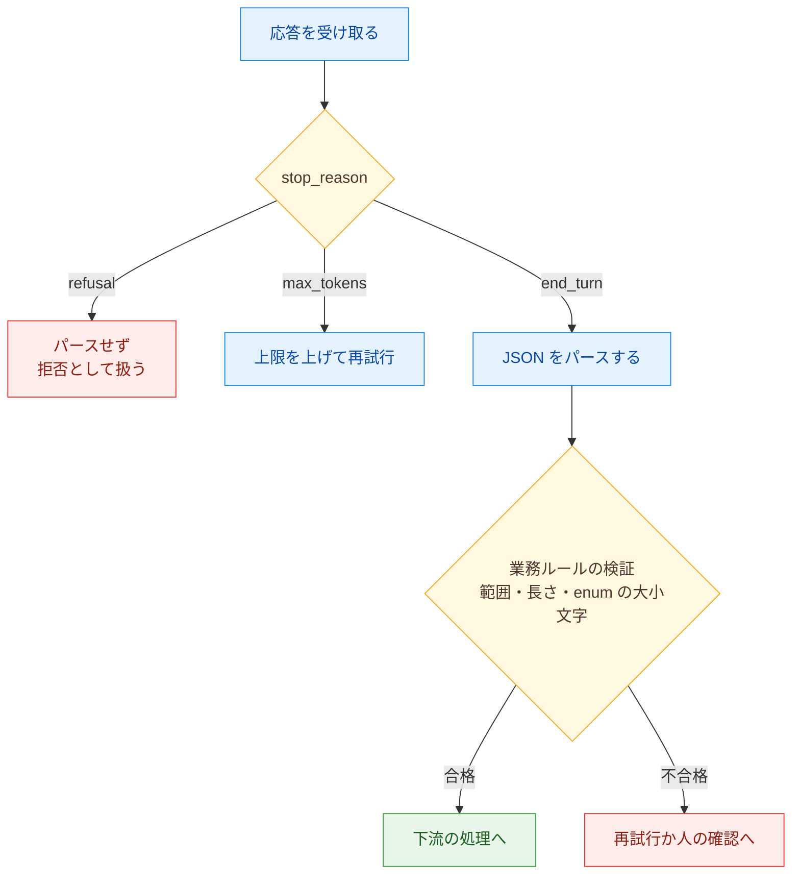

# 構造化出力と防御的なパース

> ドメイン: 6. プロンプトとコンテキストのエンジニアリング（15%） ／ 更新: 2026-11-26

!!! abstract "ひとことで"
    出力の形は構造化出力（structured outputs）で縛り、受け取る側でも ==`stop_reason` の確認と業務ルールの検証==を続ける。構造化出力を使えない呼び出しの自由文は、決めた形で解析し、解析できなければ再試行か人の確認に回す。

## 仕組み

構造化出力は、JSON スキーマを文法に変えて生成そのものを縛る（constrained decoding）。最終の応答を縛るのが `output_config.format`（`type: "json_schema"`）、ツールの入力を縛るのがツール定義の `strict: true` で、併用もできる。これで JSON の構文エラーや必須フィールドの欠けは起きなくなる。それでも、下流のコードを守る検証は要る。スキーマに合わない出力が返る場面が残り、スキーマで書けない制約もあるからだ。

| 残るリスク | 何が起きるか | 受け取る側の手当て |
|---|---|---|
| `stop_reason: "refusal"` | 拒否の文が優先され、スキーマに合わないことがある | パースの前に `stop_reason` で分岐する |
| `stop_reason: "max_tokens"` | 途中で切れた JSON | 完了として扱わず、`max_tokens` を上げて再試行 |
| enum の大小文字 | スキーマと大小文字だけ違う値が、エラーなしで返る | 大小文字を区別せずに比べる |
| スキーマで書けない制約 | `minimum`・`maxLength` などは API のスキーマで使えない | 説明文に移し、受け取った後にコードで検証する |

SDK の補助（Python の `parse()`、TypeScript の `zodOutputFormat()`）は、API で表せない制約を説明文に移し、受け取った値を手元で検証する。`jsonSchemaOutputFormat()` は検証しないので、自分で検証を書く。構造化出力を使えない呼び出しもある。たとえば citations とは併用できない。そのときは ==1項目1行など決めた形で答えさせ==、コードで解析する。解析できなかったものを空の値で埋めて先へ流すと、壊れたデータが下流に広がる。

??? info "スキーマと API の細かい決まり（2026-11 時点）"
    - 使えないもの: 再帰的なスキーマ、`oneOf`（`anyOf` を使う）、`not`、数値の `minimum`・`maximum`・`multipleOf`、文字列の `minLength`・`maxLength`、配列の `minItems` の 0・1 以外、外部の `$ref`。使うと 400 エラー
    - object には `additionalProperties: false` が要る。キーを並べない map（Python の `dict`、Zod の `z.record()`）は `{}` しか返せない。キーが事前に分からないなら、`key` と `value` を持つ要素の配列にする
    - 出力では、必須のプロパティが先、任意のプロパティが後に並ぶ
    - 上限: `strict: true` のツールは1リクエスト20個まで、任意パラメータは合計24個、union 型のパラメータは合計16個。超えると「Schema is too complex for compilation」の 400。文法のコンパイルには 180 秒のタイムアウトがある
    - 初回は文法のコンパイルで遅れる。コンパイル済みの文法は最後に使ってから24時間キャッシュされ、スキーマの構造やツールの集合を変えると作り直しになる。`output_config.format` を変えると、その会話の prompt cache も無効になる
    - citations とは併用できず（400）、prefill とも併用できない。旧パラメータ `output_format` は非推奨で、使うには beta ヘッダー `structured-outputs-2025-11-13` が要る
    - 文法は Claude の直接の出力にだけかかり、thinking には及ばない。推論の過程をプロパティで求めると `reasoning_extraction` の拒否になりうるので、短い説明を求める
    - HIPAA の対象だが、スキーマ（プロパティ名、enum、pattern）に PHI を書いてはいけない

## 試験での見分け方

| 問われること | ○ 正しい | × ひっかけ |
|---|---|---|
| 構造化出力でもパースが失敗することがある | `stop_reason` を先に見て、`max_tokens` と `refusal` を分ける | 「必ず有効な JSON を返せ」と指示を強める |
| 金額が負にならないことを保証したい | 受け取った後にコードで範囲を検証する | スキーマに `minimum: 0` を書けば API が守ると考える |
| 下流が enum で分岐している | 大小文字を区別せずに比べる | 完全一致で比べ、一致しなければ例外にする |
| 解析できない出力が来た | 再試行か、人の確認の待ち行列に回す | 空の dict や既定値で埋めて次の工程へ流す |
| 構造化出力を使えない呼び出し | 決めた形で答えさせ、コードで解析と検証をする | prefill で `{` を入れて JSON を強制する |

## 確認問題

**Q1.** 請求書から項目を抜き出すパイプラインで、`output_config.format` に JSON スキーマを指定している。ログでは、明細の多い請求書だけ、ときどき JSON のパースで例外が出る。例外が出た応答はどれも `stop_reason` が `max_tokens` だった。最も適切な直し方はどれか。（1つ選べ）
{ .quiz-q }

- A. システムプロンプトに「必ず完全で有効な JSON だけを返すこと」と書き足す
- B. パースの例外を捕まえて空の dict を返し、次の工程はそのまま続ける
- C. パースの前に、足りない閉じ括弧を正規表現で補ってから読み込む
- D. パースの前に `stop_reason` を確かめ、`max_tokens` なら上限を上げて再試行する

??? success "答えと解説"
    **正解: D。** 出力が上限で切れているので、完了として扱わず、上限を上げて取り直す。

    - A: 切れる原因は出力の上限で、指示では変わらない
    - B: 壊れた請求書が空のデータとして下流に流れ、失敗が見えなくなる
    - C: 括弧を補っても、切れた後ろの明細は失われたまま

**Q2.** 経費データを抜き出す呼び出しのスキーマで、`amount` は0以上、`currency` は `"JPY"` か `"USD"` の enum にしたい。下流のコードを守る設計として適切なものはどれか。（2つ選べ）
{ .quiz-q }

- A. 0以上という制約は API のスキーマで表せないので、説明文に移し、受け取った後にコードで検証する
- B. enum の値は大小文字だけ違うことがあるので、大小文字を区別せずに比べる
- C. constrained decoding で形が保証されるので、受け取った後の検証は省く
- D. 型の崩れを防ぐため、スキーマのすべての object で `additionalProperties` を `true` にする
- E. 通貨ごとの内訳はキーが決まらないので、`dict` 型のフィールドで返させる

??? success "答えと解説"
    **正解: A と B。** 構造化出力が保証するのは形までで、範囲と enum の大小文字は受け取る側で確かめる。

    - C: `minimum` は API のスキーマで使えず、enum の大小文字も保証されない
    - D: 構造化出力では `additionalProperties` は `false` でなければならない
    - E: キーを並べない object は `{}` しか返せない。キーと値を持つ要素の配列にする

**Q3.** 規程の文書から条件を抜き出し、各値に出典を付けたい。citations を有効にした文書と `output_config.format` を同じリクエストで送ったところ、400 エラーになった。最も適切な対応はどれか。（1つ選べ）
{ .quiz-q }

- A. `output_config.format` をやめ、旧パラメータの `output_format` で同じスキーマを送る
- B. `output_config.format` を外し、1項目1行で答えさせ、行をコードで解析して検証する
- C. 一部の文書だけ citations を無効にし、残りの文書で構造化出力と併用する
- D. 最後の assistant ターンに `{` を prefill して、JSON の形で始めさせる

??? success "答えと解説"
    **正解: B。** citations と構造化出力は併用できないので、決めた形の自由文を受け取り側で解析する。

    - A: 旧パラメータも構造化出力なので、併用できない点は同じ
    - C: citations を有効にした文書と無効の文書は、1つのリクエストで混ぜられない
    - D: 新しいモデルでは prefill が 400 になり、prefill は JSON 出力とも併用できない

## 出典
- Claude Certified Developer – Foundations Exam Guide v1.1（Dec 7 版）, Domain 6: Structured Output and Defensive Parsing（公式、PDF）: https://cc.sj-cdn.net/instructor/6nizmqk8tpzpfjvt6qmmav7rh/public/1794946771/Claude_Certified_Developer_-_Foundations_Exam_Guide_Updated_Dec_7.pdf
- [Structured outputs](https://platform.claude.com/docs/en/build-with-claude/structured-outputs)（公式）
- [Citations](https://platform.claude.com/docs/en/build-with-claude/citations)（公式、「Get structured data with citations」の節）
- [Prompting best practices](https://platform.claude.com/docs/en/build-with-claude/prompt-engineering/claude-prompting-best-practices)（公式、prefill の移行）
