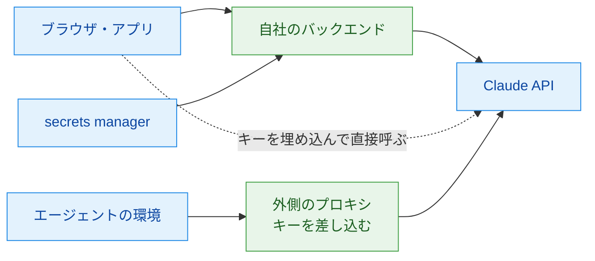

# API キーと認証情報の扱い

> ドメイン: 7. セキュリティと安全性（8%） ／ 更新: 2026-11-26

!!! abstract "ひとことで"
    Claude API のキーは==自社のサーバー側にだけ置き==、ブラウザやアプリに埋め込まない。環境ごとに workspace を分け、その workspace だけで効くキーを workload ごとに持たせる。Admin API キーは組織を管理する別物なので、推論には使わず、持つ人を絞る。

## 仕組み

ブラウザで動くコードに入れたキーは、そのページを開いた誰でも読める。だからフロントエンドは自社のバックエンドを呼び、バックエンドが secrets manager から読んだキーで Claude API を呼ぶ。エージェントを動かす環境でも同じで、外側のプロキシがキーを差し込めば、エージェントはキーを一度も見ない。注入でエージェントが乗っ取られても、キーは持ち出されない。



点線の経路は避ける道だ。キーの種類は次のとおり。

| キー | 誰として動くか | 使う場面 |
|---|---|---|
| 個人キー | 自分（自分のロールと権限） | 自分だけが使う手元のツール |
| サービスアカウントのキー | サービスアカウント | CI や本番のサービスなど、共有・無人の workload |
| workspace キー（レガシー） | 誰でもない（workspace に属する） | 新しく作らない。上の2つか WIF に移す |
| Admin API キー（`sk-ant-admin01-`） | 組織の管理者 | メンバー・workspace・キーの管理、使用量やコストの取得 |

個人キーとサービスアカウントのキーは、作るときに1つの workspace に限定できる。==workspace に限定したキー==は、その workspace の中だけで効き、漏れても被害がその範囲に収まる。workspace は開発・ステージング・本番やチームを分ける単位で、workspace ごとに月の支出上限と rate limit（RPM・入力 TPM・出力 TPM）を設定できる。開発のループが暴走しても、本番の枠を食いつぶさない。Admin API キーは選べるスコープが無く、受け付ける API すべてに全権で効く。だから推論のキーと混ぜず、持つ人を最小にする。

??? info "細かい決まり・例外"
    - workspace に限定していないキーは、毎回 `anthropic-workspace-id` ヘッダーが必要。無いと 400 `invalid_request_error`。アクセスできない workspace を指定すると 404
    - Admin API は、個人キー・サービスアカウントのキーを受け付けるが、workspace に限定していないものに限る。サービスアカウントと federation の管理エンドポイントは Admin API キーも受け付けず、`org:admin` スコープの OAuth トークンだけが通る
    - Admin API キーの対応 API（Console の組織）: Admin API、Usage and Cost Analytics API、Rate Limits API、Claude Code Analytics API など。Messages API は一覧に無い
    - 有効期限: 3時間・1日・7日・30日・任意・Never から作成時に選び、あとで変えられない。期限切れは 401 で、再有効化できない。Disable は戻せるが、Delete は戻せない（archived になる）
    - workspace の上限は組織の上限を超えて引き上げられない。workspace をアーカイブすると、その workspace のキーはすべてアーカイブされる
    - ローテーション: サポート記事は「例えば90日ごと」に作り直し、古いキーを無効にすることを勧める。Logs・Usage のページを定期的に見る
    - 静的なキーを無くす方法: 本番・CI は Workload Identity Federation（IdP のトークンを短命のアクセストークンに交換）、手元は `ant auth login`、配布する iOS・macOS アプリは App Attest
    - ブラウザから直接呼ぶには `anthropic-dangerous-direct-browser-access: true` が要る。ZDR の組織などは、このヘッダーがあっても拒否される
    - 公開の GitHub リポジトリでキーが見つかると、Anthropic がそのキーを自動で無効にし、利用者に通知する

## 試験での見分け方

<div class="vs" markdown>

| 問われること | ○ 正しい | × ひっかけ |
|---|---|---|
| ブラウザ・モバイルからの利用 | 自社のバックエンドを経由する | キーをバンドルに入れる、実行時に fetch で配る、難読化する |
| 環境の分離 | 環境ごとに workspace、上限、限定したキーを分ける | 1本のキーを全環境で共有する |
| 共有の workload | サービスアカウントのキーか WIF | 担当者の個人キーを共有する（退職で止まる） |
| 組織の管理の自動化 | Admin API キーを管理用だけに使う | Admin API キーで推論もする |
| 漏えいの疑い | 無効化・削除して作り直し、使用量を確かめる | 期限切れを待つ |

</div>

## 確認問題

**Q1.** 顧客向けの FAQ チャットを React の SPA で作り、`new Anthropic({ apiKey: import.meta.env.VITE_ANTHROPIC_KEY, dangerouslyAllowBrowser: true })` で直接 Claude API を呼んでいる。公開の翌週から、知らない IP アドレスからの使用量が急に増えた。最も適切な対応はどれか。（1つ選べ）
{ .quiz-q }

<div class="quiz" data-answer="A" markdown>

- A. ブラウザからの直接の呼び出しをやめて自社のバックエンド経由にし、漏れたキーは無効にして作り直す
- B. キーをビルド時に埋め込まず、ページを開いたときに自社のサーバーから fetch で受け取る形にする
- C. キーに7日の有効期限を付けて作り、毎週新しいキーに差し替えてビルドし直す
- D. キーの文字列を難読化してからバンドルに入れ、開発者ツールで読みにくくする

</div>

??? success "答えと解説"
    **正解: A。** ブラウザで動くコードに届いたキーは、誰でも読める。キーはバックエンドにだけ置く。

    - B: 受け取ったキーはブラウザのメモリに入るので、やはり読める
    - C: 期限は漏れたキーの寿命を縮めるだけで、毎回漏れる構造は残る
    - D: 難読化は戻せる。ネットワークの通信からもキーは見える

**Q2.** ある SaaS 企業は、Default Workspace に作ったキー1本を、開発・ステージング・本番・夜間バッチのすべてで使っている。ある日、開発者のテストのループが暴走して月の予算を使い切り、本番が rate limit に当たった。再発を防ぐ変更として適切なものはどれか。（2つ選べ）
{ .quiz-q }

<div class="quiz" data-answer="C,D" markdown>

- A. 全環境のキーを Admin API キーに替え、管理者の権限で rate limit に当たらないようにする
- B. キーは1本のまま、開発者ごとの予算の目安をシステムプロンプトに書いて守らせる
- C. 開発・ステージング・本番を別の workspace に分け、それぞれに支出上限と rate limit を設定する
- D. 環境ごとにサービスアカウントを作り、その workspace に限定したキー（または WIF）を割り当てる
- E. 本番の workspace の rate limit を、組織の上限より高い値に設定し直す

</div>

??? success "答えと解説"
    **正解: C と D。** 枠を workspace で分け、キーも workload と workspace ごとに分ければ、1つの暴走が他へ広がらない。

    - A: Admin API キーは組織の管理用で、推論のキーではない。全権のキーを配ると被害も広がる
    - B: プロンプトの目安では、ループの暴走を止められない
    - E: workspace の上限は、組織の上限を超えて引き上げられない

**Q3.** レガシーの workspace キーを、workspace に限定しないサービスアカウントのキーに移した。すると全リクエストが次のエラーで失敗した。最も適切な直し方はどれか。（1つ選べ）
{ .quiz-q }

```
400 invalid_request_error: This API key is not scoped to a workspace, so this request
must include the anthropic-workspace-id header with the ID of the workspace to use.
```

<div class="quiz" data-answer="B" markdown>

- A. キーを Admin API キーに替え、組織のどの workspace でも使えるようにする
- B. 各リクエストに `anthropic-workspace-id` を付けるか、その workspace に限定したキーを作り直す
- C. `x-api-key` ヘッダーをやめ、`Authorization: Bearer` でキーを送るように変える
- D. キーの有効期限が切れているので、Console で再有効化してから送り直す

</div>

??? success "答えと解説"
    **正解: B。** workspace に限定していないキーは、どの workspace で動くかをヘッダーで毎回示す必要がある。

    - A: Admin API キーは推論用ではなく、権限も広すぎる
    - C: どちらのヘッダーでもキーは送れる。workspace の指定が無い点は変わらない
    - D: 期限切れなら 401 になる。期限切れのキーは再有効化できない

## 出典
- Claude Certified Developer – Foundations Exam Guide v1.1、Domain 7（公式、PDF）: https://cc.sj-cdn.net/instructor/6nizmqk8tpzpfjvt6qmmav7rh/public/1794946771/Claude_Certified_Developer_-_Foundations_Exam_Guide_Updated_Dec_7.pdf
- [Authentication](https://platform.claude.com/docs/en/manage-claude/authentication)（公式。キーの種類、workspace の指定、有効期限、ブラウザからの利用、WIF、App Attest）
- [Create an Admin API key](https://platform.claude.com/docs/en/manage-claude/admin-api-keys)（公式。プレフィックス、スコープ、対応する API）
- [Workspaces](https://platform.claude.com/docs/en/manage-claude/workspaces)（公式。環境の分離、ロール、支出上限と rate limit、アーカイブ）
- [API key best practices](https://support.claude.com/en/articles/9767949-api-key-best-practices-keeping-your-keys-safe-and-secure)（公式ヘルプセンター。ローテーション、用途ごとのキー、監視、GitHub での自動無効化）
- [Securely deploying AI agents](https://code.claude.com/docs/en/agent-sdk/secure-deployment)（公式。プロキシでの資格情報の差し込み）
