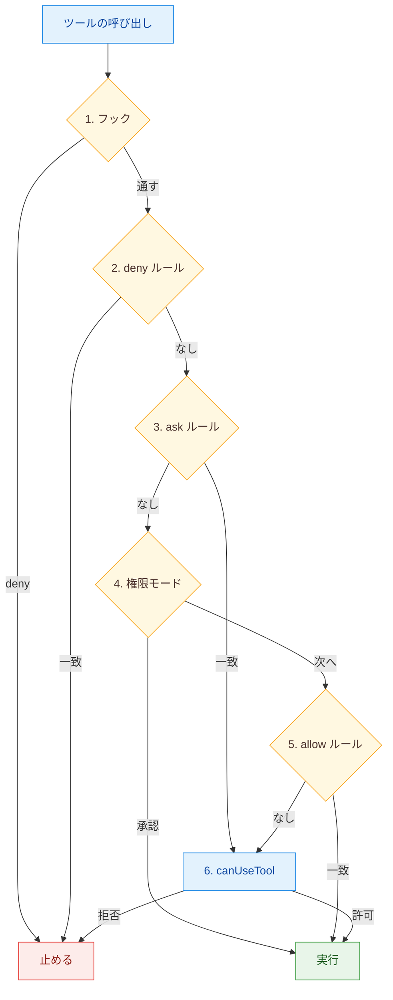

# 決定的なガードレールと最小権限

> ドメイン: 7. セキュリティと安全性（8%） ／ 更新: 2026-11-26

!!! abstract "ひとことで"
    破壊的な操作は、プロンプトの指示でなく==実行の側の仕組みで止める==。ツールを渡さない、deny ルール、`PreToolUse` フック、サンドボックスやコンテナを重ね、モデルがどう指示されても実行できない状態にする。

## 仕組み

「`.env` を編集しない」と CLAUDE.md やスキルに書くのは依頼で、保証ではない。注入やモデルの誤りで指示が破られても止まるのは、ツールの呼び出しを Claude Code（Agent SDK）が実行の前に調べる仕組みだけだ。Agent SDK は呼び出しを次の順で評価する。



フックの deny と deny ルールは、権限モードより前に評価される。だから ==`bypassPermissions` でも効く==。逆に `allowedTools` は「自動で承認する一覧」であって、制限ではない。一覧に無いツールも呼び出しは評価に進み、`bypassPermissions` ならそのまま承認される。止めたいツールは、`disallowedTools` に素の名前（例: `"Bash"`）で書いて定義ごと外すか、フックで deny する。

ルールとフックはツールの入力の文字列を見るだけなので、同じ操作を別の書き方でされると漏れる。`Bash(rm *)` の deny は `/bin/rm` を止めない。`Edit(//secrets/**)` の deny は、Claude が実行したスクリプトが自分でファイルを開いて書くのを止めない。漏れを塞ぐのは OS の層で、読み取り専用のマウント、サンドボックス、ネットワークの許可リストがそれにあたる。

| 資源 | 最小権限の取り方 |
|---|---|
| ファイル | 要るディレクトリだけをマウントし、できれば読み取り専用 |
| ネットワーク | プロキシで、決めた宛先だけに絞る |
| 資格情報 | エージェントに渡さず、外のプロキシで差し込む |
| システム | コンテナで Linux capabilities を落とし、root で動かさない |

??? info "細かい決まり・例外"
    - フックの書き方: `PreToolUse` で `hookSpecificOutput` に `permissionDecision: "deny"` と `permissionDecisionReason` を返す。理由は Claude に伝わる
    - 複数の `PreToolUse` フックの判定が食い違ったら、`deny` > `defer` > `ask` > `allow` の順で強い方が勝つ。フックが `allow` を返しても、deny ルールと ask ルールの評価は飛ばない
    - 締めたエージェントは `allowedTools` と `permissionMode: "dontAsk"` を組み合わせる。確認を求めるはずの呼び出しは、すべて拒否になる
    - `canUseTool` は、前の段で自動承認された呼び出しには呼ばれない。承認済みの呼び出しも調べたいなら `PreToolUse` フックに書く
    - `rm -rf ~` のような重要なパスの削除は、allow ルールでもフックの `allow` でも自動承認されない。ただし、この検出は漏れることがあると公式が注記している
    - 隔離の強さ（公式の比較）: sandbox-runtime（手軽、ホストのカーネルを共有）、Docker（設定しだい）、gVisor・VM（強い、負荷が大きい）。sandbox-runtime の既定のプロキシは TLS の中身を見ないので、許可した宛先経由の持ち出しは別に考える

## 試験での見分け方

<div class="vs" markdown>

| 問われること | ○ 正しい | × ひっかけ |
|---|---|---|
| 「絶対にしてはいけない」操作 | `PreToolUse` フックか deny ルールで止める | CLAUDE.md・system prompt・スキルに書く |
| `bypassPermissions` で特定のツールを止めたい | `disallowedTools` かフックの deny | `allowedTools` から外せば止まると考える |
| 締めたヘッドレスのエージェント | `allowedTools` ＋ `dontAsk` | `allowedTools` ＋ `bypassPermissions` |
| コマンドの書き方を変えたすり抜け | 読み取り専用のマウントやサンドボックスで塞ぐ | パターンの deny を増やし続ける |
| 自動承認された呼び出しの検査 | `PreToolUse` フックに書く | `canUseTool` に書く |

</div>

## 確認問題

**Q1.** CI でリポジトリの調査だけをさせる Agent SDK のエージェントを、次の設定で動かしている。ある実行のトレースに、`Bash` で `git push --force` が実行された記録があった。原因と直し方として最も適切なものはどれか。（1つ選べ）
{ .quiz-q }

```ts
options: { allowedTools: ["Read", "Grep", "Glob"], permissionMode: "bypassPermissions" }
```

<div class="quiz" data-answer="C" markdown>

- A. `allowedTools` に無い `Bash` が動いたので SDK の不具合と見て、SDK のバージョンを上げる
- B. system prompt に「push は禁止」と書き、CLAUDE.md にも同じ規則を書いて二重にする
- C. `bypassPermissions` では `allowedTools` は制限にならない。`dontAsk` にし、`Bash` を `disallowedTools` で外す
- D. `canUseTool` を足し、`git push` を含む呼び出しをその中で拒否する

</div>

??? success "答えと解説"
    **正解: C。** `allowedTools` は自動承認の一覧で、`bypassPermissions` では一覧に無いツールも承認される。

    - A: 文書どおりの動作で、不具合ではない
    - B: 指示は保証にならない。注入やモデルの誤りで破られる
    - D: `bypassPermissions` では呼び出しの多くが前の段で承認され、`canUseTool` まで届かない

**Q2.** 金融機関のデータ分析エージェントは `Bash` を使う。要件は「`/data/prod` 以下のファイルは、どんな指示を受けても消したり書き換えたりできないこと」。この要件を決定的に満たす対策はどれか。（2つ選べ）
{ .quiz-q }

<div class="quiz" data-answer="B,E" markdown>

- A. CLAUDE.md の先頭に「`/data/prod` は変更禁止」と書き、毎回読み込ませる
- B. Bash のサンドボックスを有効にして `sandbox.filesystem.denyWrite` に `/data/prod` を入れ、サンドボックスの外で動く Claude のファイル操作ツールには `Edit(//data/prod/**)` の deny ルールを足す
- C. `disallowedTools` に `"Bash(rm -rf /data/prod*)"` を1行だけ足して済ませる
- D. auto モードにして、分類器に危険な操作かどうかを判断させる
- E. `/data/prod` を読み取り専用でマウントしたコンテナかサンドボックスの中でエージェントを動かす

</div>

??? success "答えと解説"
    **正解: B と E。** どちらも、コマンドの書き方によらず書き込みを止める。サンドボックスは Bash とその子プロセスの書き込みを OS の層で止め、サンドボックスの外で動く `Edit`・`Write` は `Edit(...)` の deny ルールで止まる。コンテナの読み取り専用のマウントも OS の層の強制だ。

    - A: 指示は依頼で、保証にならない
    - C: `/bin/rm`、`find -delete`、スクリプト経由の書き込みなど、書き方を変えると通る。`PreToolUse` フックで入力の文字列を調べる方法も、同じ弱点を持つ
    - D: 分類器はモデルの判断で、決定的な強制ではない

**Q3.** あるエージェントに `PreToolUse` フックが2つある。監査用のフックは、記録を残して常に `permissionDecision: "allow"` を返す。保護用のフックは、`.env` への `Edit` に `"deny"` を返す。Claude が `.env` を編集しようとしたときの結果として正しいものはどれか。（1つ選べ）
{ .quiz-q }

<div class="quiz" data-answer="A" markdown>

- A. `deny` が `allow` より優先されるので、編集は止まる
- B. 先に登録されたフックの判定が採用されるので、登録の順番しだいで結果が変わる
- C. `allow` が返った時点で残りの評価が飛ばされるので、編集は実行される
- D. 判定が食い違ったときは `ask` 扱いになり、`canUseTool` で確認される

</div>

??? success "答えと解説"
    **正解: A。** 複数の `PreToolUse` フックの判定は `deny` > `defer` > `ask` > `allow` の順に強い。

    - B: 登録の順番では決まらない
    - C: フックの `allow` でも、ほかの deny や deny ルールの評価は飛ばない
    - D: 食い違いは強い判定で決まり、`ask` に読み替えられることはない

## 出典
- Claude Certified Developer – Foundations Exam Guide v1.1、Domain 7（公式、PDF）: https://cc.sj-cdn.net/instructor/6nizmqk8tpzpfjvt6qmmav7rh/public/1794946771/Claude_Certified_Developer_-_Foundations_Exam_Guide_Updated_Dec_7.pdf
- [Configure permissions（Agent SDK）](https://code.claude.com/docs/en/agent-sdk/permissions)（公式。評価の順番、`allowedTools` と `bypassPermissions`、`dontAsk`、パスのルール）
- [Intercept and control agent behavior with hooks（Agent SDK）](https://code.claude.com/docs/en/agent-sdk/hooks)（公式。`permissionDecision`、複数フックの優先順位）
- [Extend Claude Code（Hook vs Skill）](https://code.claude.com/docs/en/features-overview)（公式。「Put guardrails in hooks」）
- [Securely deploying AI agents](https://code.claude.com/docs/en/agent-sdk/secure-deployment)（公式。最小権限の表、隔離の技術の比較）
- [Sandboxing](https://code.claude.com/docs/en/sandboxing)（公式。Bash のサンドボックスは OS の層で子プロセスまで強制、`sandbox.filesystem.denyWrite`、ファイル操作ツールはサンドボックスの外で権限ルールに従う）
