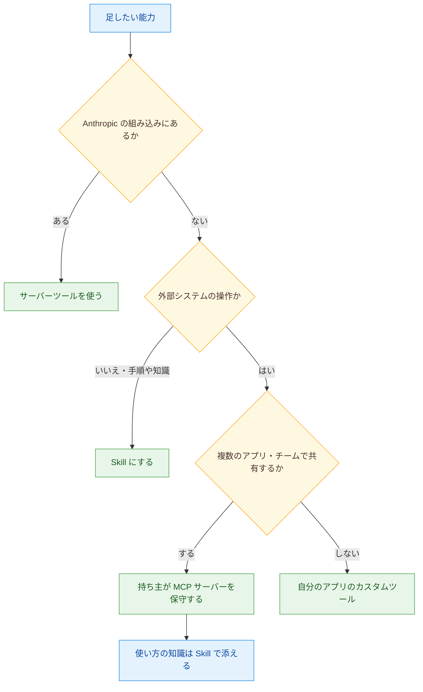

# 機能の仕組みの選択（組み込みツール・カスタムツール・Skills・MCP）

> ドメイン: 8. ツールと MCP（10%） ／ 更新: 2026-11-26

!!! abstract "ひとことで"
    ==どこで動くか、誰が保守するか、Claude がどう見つけて呼ぶか==の3つで選ぶ。汎用の機能は組み込みツール、自分のアプリの処理はカスタムツール、手順・知識・定型の処理は Skills、複数のクライアントで共有する外部システムは MCP サーバーにする。

## 仕組み

4つの仕組みは、どれも Claude に新しい能力を足すが、置き場所と持ち主が違う。外部システムにつなぐのは、ツールか MCP だ。Skills は「どうやるか」を教える。

| 仕組み | どこで動くか | 誰が保守するか | Claude がどう見つけ、呼ぶか |
|---|---|---|---|
| 組み込みのサーバーツール（`web_search`、`web_fetch`、`code_execution`、`tool_search`） | Anthropic の基盤 | Anthropic | `tools` に `type` で宣言し、Claude が呼ぶ。結果は同じ応答に入る |
| Anthropic がスキーマを決めたクライアントツール（`bash`、`text_editor`、memory など） | 自分のアプリ | スキーマは Anthropic、実行は自分 | `type` で宣言する。Claude はスキーマを学習済み |
| カスタムツール | 自分のアプリ | 自分 | 毎回の `tools` に名前・説明・スキーマを渡し、`tool_use` で呼ばれる |
| Skills | code execution のコンテナ（API）、手元のファイル（Claude Code） | 自分やチーム | 名前と説明（1つ約100トークン）が常に入り、合えば `SKILL.md` を読む。スクリプトは実行して出力だけが入る |
| MCP サーバー | 別のプロセスか、リモートのサービス | そのシステムの持ち主 | クライアントがツールの一覧を取得する。Claude Code・Agent SDK・Messages API（tools のみ）から使える |

同じ処理を各チームがカスタムツールで書き写すと、仕様が変わるたびに全員が直すことになる。だから、使う側が多いシステムは、持ち主が1つの MCP サーバーとして保守する。Skills は段階的に読み込まれる（progressive disclosure）ので、長い手順書や参考資料を毎回の system prompt に貼るより安い。ただし ==API 上の Skill はネットワークに出られない==。外部の API を呼ぶ処理は、Skill でなくツールか MCP に置く。Skill は MCP と組み合わせられ、MCP が接続を、Skill がその使い方（スキーマの意味やよく使う問い合わせ）を受け持つ。

??? info "細かい決まり・例外"
    - Skills の読み込みの段階: メタデータ（常に、約100トークン/個）、`SKILL.md` の本文（呼ばれたとき、5k トークン未満）、同梱のファイル（必要なときだけ）
    - Messages API で Skills を使うには、code execution ツールを入れ、`container.skills` に `type` と `skill_id` を並べる。組み込みの Skill は `pptx`・`xlsx`・`docx`・`pdf`
    - API の Skill の実行環境: ネットワークなし、実行時のパッケージの追加なし。Claude Code の Skill は、利用者の PC と同じネットワークに出られる
    - 自作の Skill は面（claude.ai・API・Claude Code）をまたいで同期しない。API でアップロードした Skill は workspace の全員が使える。Claude Code では `~/.claude/skills/`・`.claude/skills/`・plugin で配る
    - Skill は信頼できる出どころのものだけを使う。悪意のある Skill は、ツールの悪用やデータの持ち出しを指示できる
    - MCP connector（Messages API）は tools だけに対応し、HTTPS で公開したサーバーにしかつなげない
    - サーバーツールは、トークンとは別に使用量の料金がかかることがある（例: Web 検索は検索の回数ごと）
    - Claude Code の中で決まって毎回動かす処理（整形、危険なコマンドの拒否）は、Skill でなくフックに置く

## 試験での見分け方

| 問われること | ○ 正しい | × ひっかけ |
|---|---|---|
| 毎回貼っている長い手順書・テンプレート | Skill にして、必要なときだけ読ませる | 毎回の system prompt に貼り続ける、MCP の prompts にする |
| 多くのクライアントが使う社内システム | 持ち主が保守する MCP サーバー | 各チームのアプリにカスタムツールを書き写す |
| API 上の Skill から外部 API を呼ぶ | ツールか MCP に移す | Skill の中のスクリプトで HTTP を呼ぶ |
| Web 検索・ページ取得 | 組み込みのサーバーツールを使う | 自前のスクレイパーを作って保守する |
| 自分のアプリにしか無い処理 | カスタムツール | 1か所でしか使わないのに MCP サーバーを立てる |

## 確認問題

**Q1.** 法務チームは、Claude API で契約書の下書きを社の書式で作らせている。書式のテンプレートと、条項の抜けを調べる検証スクリプトがあり、いまは約4,000トークンの手順書を毎回の system prompt に貼っている。外部システムへの接続は要らない。最も適切な仕組みはどれか。（1つ選べ）
{ .quiz-q }

- A. 手順書を MCP サーバーの prompts として公開し、Messages API の MCP connector から読み込ませる
- B. カスタムツール `format_contract` を作り、手順書の全文をそのツールの説明文に書き写す
- C. テンプレートと検証スクリプトを同梱した Skill にし、code execution ツールと `container.skills` で使わせる
- D. 手順書を社内 wiki に置き、`web_fetch` ツールで毎回のリクエストのたびに取得させる

??? success "答えと解説"
    **正解: C。** 手順・テンプレート・定型のスクリプトは Skill の役目で、必要なときだけ読み込まれる。

    - A: MCP connector は tools にしか対応しない。手順を配るのに MCP を立てる理由も無い
    - B: 説明文は毎回 `tools` で送られるので、トークンは減らない。スクリプトの実行もできない
    - D: 毎回の取得で遅くなる。社内 wiki は Anthropic 側から届かないことが多い（推論）

**Q2.** 在庫管理システムを、開発者の Claude Code、Agent SDK で作った社内エージェント、Messages API を使う顧客向けのバックエンドの3つから使いたい。システムは在庫チームが保守している。適切な設計はどれか。（2つ選べ）
{ .quiz-q }

- A. 在庫チームが MCP サーバーを作り、Streamable HTTP で公開して、3つのクライアントからつなぐ
- B. 3つのチームが、それぞれ自分のアプリに在庫 API を呼ぶカスタムツールを書き写す
- C. 在庫 API の仕様を Skill にまとめ、API 上の Skill のスクリプトから在庫 API を直接呼ばせる
- D. 在庫 DB の接続文字列を CLAUDE.md に書き、Bash のツールで直接 SQL を実行させる
- E. 在庫データの読み方（項目の意味、よく使う問い合わせ）を Skill にまとめ、MCP のツールと組み合わせる

??? success "答えと解説"
    **正解: A と E。** 共有する外部システムは持ち主が MCP サーバーで保守し、使い方の知識は Skill で添える。

    - B: 仕様が変わるたびに3か所を直すことになり、保守する人と置き場所がずれる
    - C: API 上の Skill はネットワークに出られない
    - D: 資格情報を平文で配り、DB を直接さわらせることになる。Messages API のバックエンドでは使えない

**Q3.** 顧客向けのリサーチ機能で、公開 Web の最新の情報を出典つきで答えさせたい。いまは自社のサーバーで動くスクレイパーをカスタムツールにしているが、保守に手間がかかり、HTML の全文を返すので結果も大きい。最も適切な変更はどれか。（1つ選べ）
{ .quiz-q }

- A. スクレイピングの手順とスクリプトを Skill にまとめ、API 上の code execution で実行させる
- B. スクレイパーを自前の MCP サーバーに移し、MCP connector からつないで使う
- C. カスタムツールのまま、HTML の全文を返して Claude に要点を探させる
- D. Anthropic 側で動く Web 検索のサーバーツールを `tools` に宣言して使う

??? success "答えと解説"
    **正解: D。** 汎用の Web 検索は組み込みのサーバーツールにあり、実装も実行も Anthropic が持つ。検索の回数ごとの料金は別にかかる。

    - A: API 上の Skill はネットワークに出られない
    - B: 置き場所が変わるだけで、スクレイパーを保守する手間は残る
    - C: 結果が大きいままで、文脈を圧迫する問題も残る

## 出典
- Claude Certified Developer – Foundations Exam Guide v1.1、Domain 8（公式、PDF）: https://cc.sj-cdn.net/instructor/6nizmqk8tpzpfjvt6qmmav7rh/public/1794946771/Claude_Certified_Developer_-_Foundations_Exam_Guide_Updated_Dec_7.pdf
- [Tool use with Claude](https://platform.claude.com/docs/en/agents-and-tools/tool-use/overview)（公式。クライアントツールとサーバーツール、料金）
- [Agent Skills](https://platform.claude.com/docs/en/agents-and-tools/agent-skills/overview)（公式。段階的な読み込み、面ごとの使い方、実行環境の制約、共有の範囲、安全）
- [Extend Claude Code](https://code.claude.com/docs/en/features-overview)（公式。MCP vs Skill、Skill + MCP の組み合わせ、Hook vs Skill）
- [MCP connector](https://platform.claude.com/docs/en/agents-and-tools/mcp-connector)（公式。tools のみ、HTTPS のみ）
