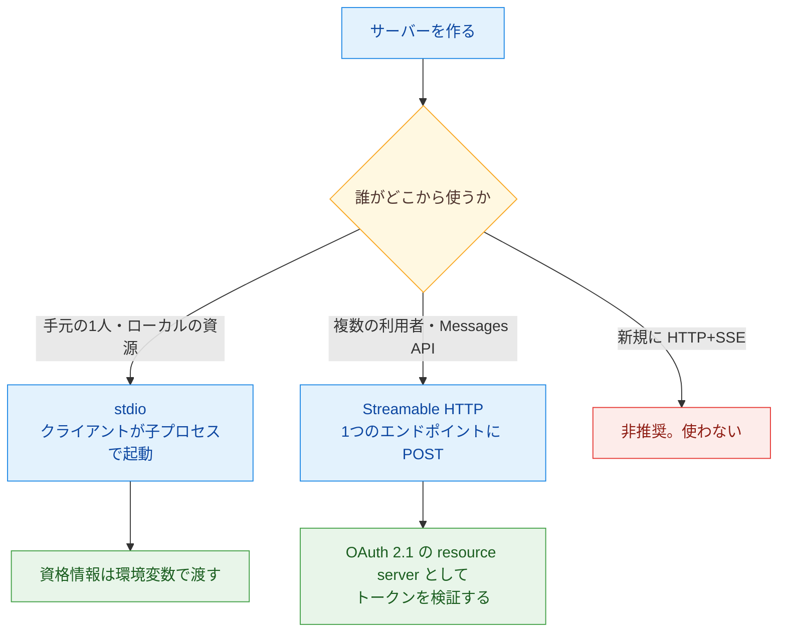

# MCP サーバーの開発と組み込み

> ドメイン: 8. ツールと MCP（10%） ／ 更新: 2026-11-26

!!! abstract "ひとことで"
    MCP サーバーは、tools（モデルが呼ぶ）・resources（アプリが渡す）・prompts（ユーザーが選ぶ）で機能を出す。==手元で1人が使うなら stdio、共有するリモートなら Streamable HTTP==。HTTP は OAuth 2.1 で守り、stdio は環境から資格情報を受け取る。

## 仕組み

MCP（Model Context Protocol）のサーバーは、1つの外部システムへの接続と認証を引き受け、どの MCP クライアントからも同じ形で使える機能を出す。3つの基本要素は、誰が使うかを決めるかで分かれる。

| 要素 | 決めるのは | 例 |
|---|---|---|
| tools | モデル | API への書き込み、検索の実行 |
| resources | アプリ（クライアント） | ファイルの中身、git の履歴 |
| prompts | ユーザー | スラッシュコマンド、メニューの項目 |



stdio では、クライアントがサーバーを子プロセスとして起動し、stdin と stdout で改行区切りの JSON-RPC をやり取りする。サーバーは ==stdout に MCP のメッセージ以外を書いてはいけない==。ログは stderr に出す。Streamable HTTP では、サーバーは独立したプロセスで多くのクライアントを受け、1つのエンドポイント（例: `https://example.com/mcp`）への POST に、JSON 1つか、その要求だけの SSE ストリームで答える。

HTTP のサーバーは OAuth 2.1 の resource server になる。トークンが無い要求には 401 と `WWW-Authenticate`（Protected Resource Metadata の URL）を返し、クライアントはそこから認可サーバーを見つける。受け取ったトークンは、自分あての audience で発行されたものかを検証する。クライアントのトークンを下流の API にそのまま渡すこと（token passthrough）は禁じられているので、下流は自分の資格情報で呼ぶ。

組み込み先ごとの違い:

| 組み込み先 | 書き方 | 注意 |
|---|---|---|
| Claude Code | `claude mcp add --transport http <name> <url>`、stdio は `claude mcp add <name> -- <command>` | スコープは local・project（`.mcp.json` で共有）・user。OAuth は `/mcp` から |
| Agent SDK | `mcpServers` に渡す。自作の関数は `createSdkMcpServer` で同じプロセス内のサーバーにできる | ツール名は `mcp__<server>__<tool>` |
| Messages API（MCP connector、beta） | `mcp_servers`（`type: "url"`、`url`、`name`、`authorization_token`）と、`tools` の `mcp_toolset` | tools だけに対応。`https://` で公開した HTTP サーバーのみで、stdio は直接つなげない。OAuth の取得と更新は呼び出し側が行う |

??? info "細かい決まり・例外"
    - 仕様の版: 2026-07-28 が現行。この版で Streamable HTTP のプロトコル上のセッション（`Mcp-Session-Id`）と GET のストリームが無くなった。2025-03-26〜2025-11-25 の版にはあった
    - HTTP の要求には `MCP-Protocol-Version`、`Mcp-Method`、`Mcp-Name`（tools/call など）のヘッダーが要る。ヘッダーと本文が食い違えば 400（`HeaderMismatch`、-32020）
    - Streamable HTTP の安全の決まり: `Origin` ヘッダーの検証は MUST（DNS rebinding 対策）。ローカルでは 127.0.0.1 にだけ bind する（SHOULD）。全接続に認証を入れる（SHOULD）
    - 認可の決まり: Protected Resource Metadata（RFC 9728）は MUST。クライアントは PKCE と `resource` パラメーター（RFC 8707）を使う。トークンは `Authorization: Bearer` で毎回送り、URL のクエリに入れない。認可は仕様全体としては OPTIONAL
    - クライアントの登録: Client ID Metadata Documents（SHOULD）、事前登録、Dynamic Client Registration（互換のために残された非推奨）
    - HTTP+SSE（2024-11-05）は 2025-03-26 から非推奨。Claude Code の `--transport sse` も非推奨扱い
    - Claude Code の `.mcp.json` では `${VAR}` と `${VAR:-default}` が展開される。リモートの `url`・`headers` では `ANTHROPIC_API_KEY` などは空として読まれる
    - MCP connector の beta ヘッダー: `mcp-client-2026-09-15` は `mcp-client-2025-11-20` のすべてを含み、サーバーが返したツールの一覧の記録と固定（pin）を足したもの。受け付けるプラットフォーム（Claude API、Google Cloud の Anthropic managed）では、2025-11-20 の代わりにこちらを送る。Claude Platform on AWS と Microsoft Foundry は 2025-11-20 だけ。旧版の `mcp-client-2025-04-04` は非推奨

## 試験での見分け方

<div class="vs" markdown>

| 問われること | ○ 正しい | × ひっかけ |
|---|---|---|
| Messages API から自作のサーバーを使う | HTTPS で公開した Streamable HTTP で、MCP connector から呼ぶ | stdio のサーバーや localhost の URL を指定する |
| stdio のサーバーが落ちる・パースエラー | ログを stderr に出す | stdout にデバッグ出力を混ぜる |
| HTTP のサーバーの認証 | audience を検証し、下流は自分の資格情報で呼ぶ | 受けたトークンを下流に転送する、クエリ文字列で受ける |
| stdio のサーバーの資格情報 | 環境変数で渡す | OAuth の画面遷移を組み込む |
| 新しく作るリモートのサーバー | Streamable HTTP | HTTP+SSE |

</div>

## 確認問題

**Q1.** 社内のチケット DB を引く MCP サーバーを stdio で作り、開発者の手元の Claude Code で使ってきた。これを本番のバックエンド（Messages API の MCP connector）からも使おうとして、次の設定でリクエストが失敗した。最も適切な対応はどれか。（1つ選べ）
{ .quiz-q }

```json
"mcp_servers": [{ "type": "url", "url": "stdio://./ticket-server", "name": "tickets" }]
```

<div class="quiz" data-answer="B" markdown>

- A. `url` を `http://localhost:3000` に変え、同じマシンでサーバーを起動しておく
- B. サーバーを Streamable HTTP にして HTTPS で公開し、その URL と `mcp_toolset` を指定する
- C. stdio のまま、`mcp_servers` に起動コマンドと引数を書く項目を足して渡す
- D. チケットの検索を resources として公開し直し、connector から読ませる

</div>

??? success "答えと解説"
    **正解: B。** MCP connector がつなげるのは、`https://` で公開した HTTP のサーバーだけで、stdio は直接つなげない。

    - A: URL は `https://` で始まる必要があり、Anthropic 側から届く公開の場所でなければならない
    - C: connector の `type` は `url` だけで、起動コマンドを渡す仕組みは無い
    - D: connector が対応するのは tools だけで、resources は使えない

**Q2.** 複数の顧客企業が使う SaaS 向けに、HTTP の MCP サーバーを作った。コードレビューで、受け取ったトークンの audience を確かめていないことと、そのトークンをそのまま下流の CRM API に転送していることが見つかった。仕様に沿った修正はどれか。（2つ選べ）
{ .quiz-q }

<div class="quiz" data-answer="B,D" markdown>

- A. トークンをヘッダーでなく URL のクエリ文字列で受け取り、ログで追いやすくする
- B. 受け取ったトークンが自サーバーあてに発行されたものかを検証し、違えば 401 を返す
- C. 下流の CRM の権限と揃うように、クライアントのトークンを転送する処理は残す
- D. 下流の CRM は、クライアントのトークンでなく、サーバーが下流向けに得た資格情報で呼ぶ
- E. トークンの検証をやめ、`Origin` ヘッダーの検証だけで接続を受け入れる

</div>

??? success "答えと解説"
    **正解: B と D。** サーバーは自分あてのトークンだけを受け入れ、他のトークンを受け取ったり中継したりしない。

    - A: アクセストークンを URI のクエリに入れることは禁じられている
    - C: token passthrough は仕様で禁じられている
    - E: `Origin` の検証は DNS rebinding 対策で、認証の代わりにならない

**Q3.** Python で書いた stdio の MCP サーバーが、ツールを呼ぶたびに `print("DEBUG: query=...")` で状況を出している。Claude Code では、そのサーバーの接続がときどき切れ、パースエラーが記録される。最も適切な直し方はどれか。（1つ選べ）
{ .quiz-q }

<div class="quiz" data-answer="A" markdown>

- A. デバッグの出力を stderr に出し、stdout には MCP のメッセージだけを書くようにする
- B. 接続を安定させるために、トランスポートを Streamable HTTP に変えて動かす
- C. デバッグの出力を JSON の形に整えてから、これまでどおり stdout に出す
- D. Claude Code の設定で、MCP のパースエラーを無視して接続を続けるようにする

</div>

??? success "答えと解説"
    **正解: A。** stdio の stdout は MCP のメッセージ専用で、ログは stderr に出す。

    - B: 原因は stdout の汚れで、トランスポートを変える必要はない。手元の1人用なら stdio が合う
    - C: JSON の形でも JSON-RPC のメッセージではないので、やはり規則に反する
    - D: 不正な出力を残したままでは、メッセージの境界が崩れ続ける

## 出典
- Claude Certified Developer – Foundations Exam Guide v1.1、Domain 8（公式、PDF）: https://cc.sj-cdn.net/instructor/6nizmqk8tpzpfjvt6qmmav7rh/public/1794946771/Claude_Certified_Developer_-_Foundations_Exam_Guide_Updated_Dec_7.pdf
- [MCP Specification 2026-07-28: Server Features](https://modelcontextprotocol.io/specification/2026-07-28/server/index)（公式。tools・resources・prompts と誰が決めるか）
- [MCP Specification 2026-07-28: Transports](https://modelcontextprotocol.io/specification/latest/basic/transports)、[stdio](https://modelcontextprotocol.io/specification/2026-07-28/basic/transports/stdio)、[Streamable HTTP](https://modelcontextprotocol.io/specification/2026-07-28/basic/transports/streamable-http)（公式）
- [MCP Specification 2026-07-28: Authorization](https://modelcontextprotocol.io/specification/2026-07-28/basic/authorization)（公式。stdio は環境から資格情報、audience の検証、token passthrough の禁止）
- [MCP connector](https://platform.claude.com/docs/en/agents-and-tools/mcp-connector)（公式。tools のみ、HTTPS のみ、`authorization_token`）
- [Connect Claude Code to tools via MCP](https://code.claude.com/docs/en/mcp)（公式。`claude mcp add`、スコープ、OAuth、環境変数の展開）
- [Give Claude custom tools（Agent SDK）](https://code.claude.com/docs/en/agent-sdk/custom-tools)（公式。`createSdkMcpServer`、ツール名の規則）
