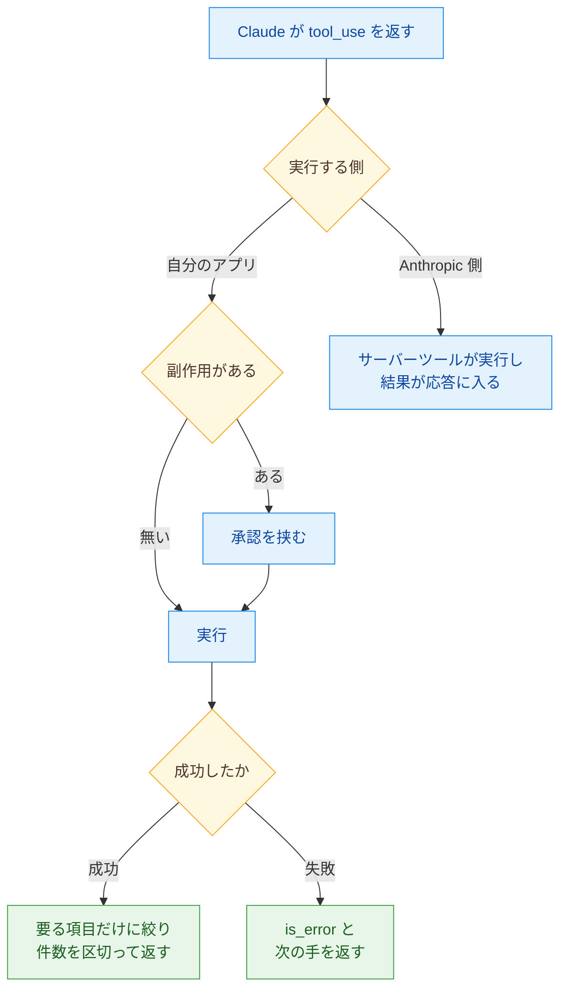

# ツールの設計と結果の整形

> ドメイン: 8. ツールと MCP（10%） ／ 更新: 2026-11-26

!!! abstract "ひとことで"
    ツールは、==いつ使い・いつ使わないかまで書いた説明==と厳密なスキーマで正しく呼ばせる。結果は次の判断に要る最小の情報だけ返し、失敗は `is_error` と次の手を返す。副作用のある操作には承認を挟む。

## 仕組み

Claude はツールの `name`・`description`・`input_schema` だけを見て、呼ぶかどうかと引数を決める。公式は説明文を「ツールの性能で最も大きな要因」とし、何をするか、いつ使うか（使わないか）、各引数の意味、返さない情報を3〜4文以上で書くよう勧めている。結果もそのまま Claude のコンテキストに積まれるので、API の応答を丸ごと返すと、文脈を圧迫して判断が鈍る。



| 設計の要素 | やること |
|---|---|
| スキーマ | 意味の分かる引数名、`enum` と `required`、`strict: true` で入力をスキーマどおりにする。形式にうるさい引数は `input_examples` |
| 道具の数と名前 | 関連する操作は `action` 引数で少ないツールにまとめる。サービス名を前に付けて名前を分ける（`github_list_prs`） |
| 結果の整形 | 意味のある安定した ID（slug や UUID）と、次の判断に要る項目だけを返す。件数の上限、絞り込み、ページ送りを付ける |
| エラー | `is_error: true` と、何が起きて次に何をすべきかを書く（`"failed"` だけにしない）。再試行の回数に上限を付ける |
| 実行する側 | 自分の処理・社内システムはクライアントツール。Web 検索などはサーバーツールで、実装も実行も Anthropic 側 |
| 承認 | 書き込み・送金・削除などは、実行の前に人の確認を通す |

結果の整形は、ツールの側で行う。プロンプトで「必要な部分だけ読め」と頼んでも、トークンはすでにコンテキストに入っている。切り詰めたときは、切り詰めたことと続きの取り方を結果に書く。そうすれば Claude は、絞った条件で呼び直せる。==失敗を成功の形で返す==と、Claude は完了したと伝えてしまう。

??? info "細かい決まり・例外"
    - `name` は `^[a-zA-Z0-9_-]{1,128}$`。任意の項目に `strict`、`input_examples`、`cache_control`、`defer_loading` などがある
    - `input_examples` は各例を自分でスキーマに照らして検証する。1例でおよそ100〜200トークン増える
    - エンジニアリングブログ（2025-09）: 既存 API をそのまま包まず、`list_contacts` より `search_contacts` のように絞って返す道具にする。`response_format`（`concise` / `detailed`）の enum で詳しさを選ばせる例がある。Claude Code はツールの応答を既定で25,000トークンに制限している
    - 理由を尋ねる引数は「短い説明・根拠」を求める形にする。思考や手順を書かせる引数は `reasoning_extraction` の refusal を招くことがある
    - Agent SDK の承認: TypeScript ではツールに `permission_policy: "always_ask"` を付けると、`allowedTools` に入れていても `canUseTool` に回る（v0.3.301 以降）。auto・plan モードでは `destructiveHint: true` も明示する
    - 注釈 `readOnlyHint: true` は、ほかの読み取り専用ツールとの並列実行を許す。注釈は申告にすぎず、強制ではない
    - ツールが多くて選択を誤るときは、tool search と `defer_loading` で必要なときだけ定義を読ませる

## 試験での見分け方

<div class="vs" markdown>

| 問われること | ○ 正しい | × ひっかけ |
|---|---|---|
| 結果が大きすぎて文脈を圧迫 | ツール側で項目と件数を絞り、続きの取り方を返す | 大きいコンテキストのモデルに替える、プロンプトで「要点だけ読め」 |
| 失敗の返し方 | `is_error: true` と、原因・次の手 | `"failed"` だけ、結果を返さずループを止める |
| 似たツールが並んで選び間違える | まとめる、名前に接頭辞、説明に使い分けを書く | 同じ機能のツールをさらに足す |
| 副作用のある操作 | 実行の前に承認を通す | 説明文に「確認すること」と書いて代える |
| Web 検索など汎用の機能 | サーバーツールを使う | 自前で同じものを作って保守する |

</div>

## 確認問題

**Q1.** カスタマーサポートのエージェントで、`search_tickets` は社内 API の応答をそのまま返している。1回の呼び出しで50件、内部用の項目を含めて約3万トークンになる。トレースでは、数回の検索のあと、エージェントが利用者の元の依頼を取り違え始めた。最も適切な直し方はどれか。（1つ選べ）
{ .quiz-q }

<div class="quiz" data-answer="D" markdown>

- A. `max_tokens` を上げ、長い結果を読んだあとでも十分な長さの回答を書けるようにする
- B. コンテキストウィンドウの大きいモデルに替え、検索結果を丸ごと保持できるようにする
- C. system prompt に「検索結果は必要な項目だけを読み、残りは無視すること」と書き足す
- D. ツール側で要る項目だけに絞って件数の上限を付け、切り詰めたことと続きの取り方を結果に書く

</div>

??? success "答えと解説"
    **正解: D。** 結果の整形はツールの側で行う。次の判断に要る情報だけが、コンテキストに入るようにする。

    - A: `max_tokens` は出力の上限で、入力が膨らむ問題とは関係ない
    - B: 容量を増やしても、関係の薄い情報が判断を鈍らせる点は残る。コストも増える
    - C: 指示を書いても、トークンはすでにコンテキストに入っている

**Q2.** 社内 IT ヘルプデスクのエージェントを TypeScript の Agent SDK で作っている。`lookup_user`（参照だけ）と `reset_user_mfa`（MFA の再設定）がある。要件は「参照は自由に、MFA の再設定は毎回オペレーターの承認を経ること」。設定として適切なものはどれか。（2つ選べ）
{ .quiz-q }

<div class="quiz" data-answer="A,C" markdown>

- A. `reset_user_mfa` に `permission_policy: "always_ask"` を付け、`canUseTool` でオペレーターに承認を求める
- B. 2つのツールを両方とも `allowedTools` に入れ、呼び出しを自動で承認する
- C. `lookup_user` に `readOnlyHint: true`、`reset_user_mfa` に `destructiveHint: true` を明示する
- D. `reset_user_mfa` の説明文に「実行の前に必ず利用者に確認すること」と書き、承認の代わりにする
- E. `reset_user_mfa` をサーバーツールとして宣言し、Anthropic 側で実行させる

</div>

??? success "答えと解説"
    **正解: A と C。** 副作用のある操作は実行の側で承認を通し、注釈で振る舞いを正しく申告する。

    - B: `allowedTools` の自動承認では、再設定の前に人が確認しない
    - D: 説明文の指示は守られる保証がなく、オペレーターの承認にもならない
    - E: 社内システムの操作は自分のアプリが実行するクライアントツールで、サーバーツールにはできない

**Q3.** パスワードを変えるツールのハンドラが、権限の不足で失敗したときに次の結果を返している。その直後、Claude は利用者に完了を伝えた。最も適切な直し方はどれか。（1つ選べ）
{ .quiz-q }

```
tool_result: {"tool_use_id": "toolu_01...", "content": "failed"}
assistant:   「パスワードの変更が完了しました。」
```

<div class="quiz" data-answer="C" markdown>

- A. system prompt に「ツール結果に failed とあれば、失敗として利用者に伝えること」と書く
- B. 失敗したときは `tool_result` を返さずに、そこでエージェントのループを終える
- C. `is_error: true` を付け、「権限不足のため変更できない。管理者の承認が必要」と原因と次の手を書く
- D. 失敗したときはハンドラで例外を投げ、API の呼び出しごと中断させる

</div>

??? success "答えと解説"
    **正解: C。** 失敗は `is_error` で示し、何が起きて次に何をすべきかを書く。

    - A: 結果の形が成功と同じままで、プロンプトの指示に頼る
    - B: ループを止めると、Claude は失敗を知らないままで、利用者に原因も次の手も伝わらない
    - D: 利用者への説明も回復の手も失われる。失敗は結果として返して、Claude に対応させる

## 出典
- Claude Certified Developer – Foundations Exam Guide v1.1、Domain 8（公式、PDF）: https://cc.sj-cdn.net/instructor/6nizmqk8tpzpfjvt6qmmav7rh/public/1794946771/Claude_Certified_Developer_-_Foundations_Exam_Guide_Updated_Dec_7.pdf
- [Define tools](https://platform.claude.com/docs/en/agents-and-tools/tool-use/define-tools)（公式。定義の項目、説明文のベストプラクティス、まとめ方、名前空間、high-signal な結果）
- [Tool use with Claude](https://platform.claude.com/docs/en/agents-and-tools/tool-use/overview)（公式。クライアントツールとサーバーツール）
- [Handle tool calls](https://platform.claude.com/docs/en/agents-and-tools/tool-use/handle-tool-calls)（公式。`is_error`、教えるエラーメッセージ、再試行の上限）
- [Give Claude custom tools（Agent SDK）](https://code.claude.com/docs/en/agent-sdk/custom-tools)（公式。注釈、`permission_policy`、エラーの返し方）
- [Writing effective tools for AI agents](https://www.anthropic.com/engineering/writing-tools-for-agents)（公式、エンジニアリングブログ、2025-09。`search_contacts`、`response_format`、25,000トークンの制限）
